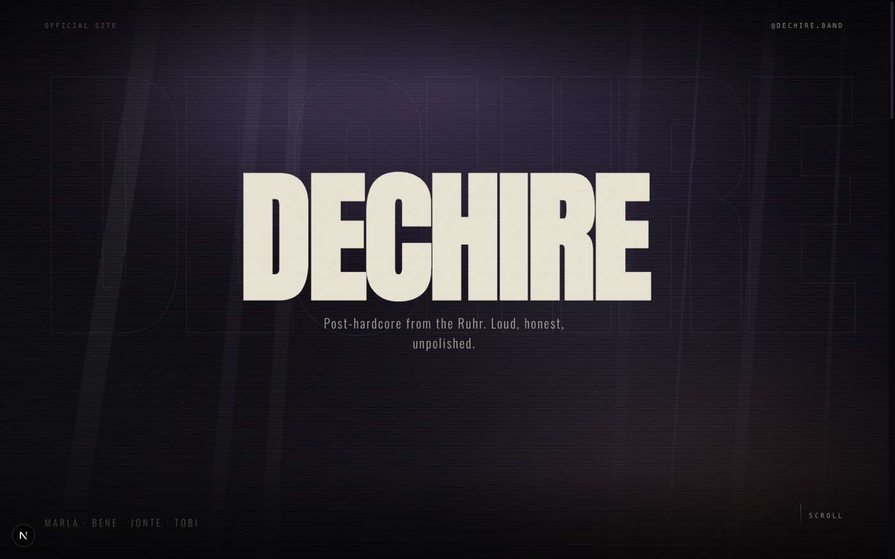
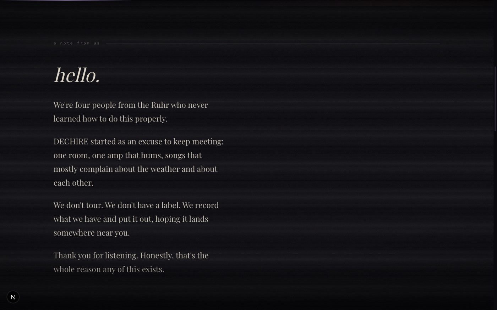
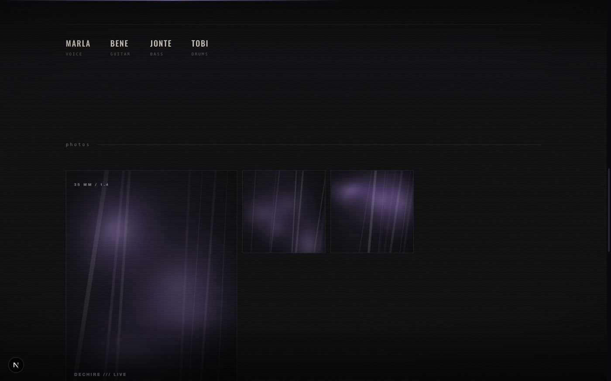
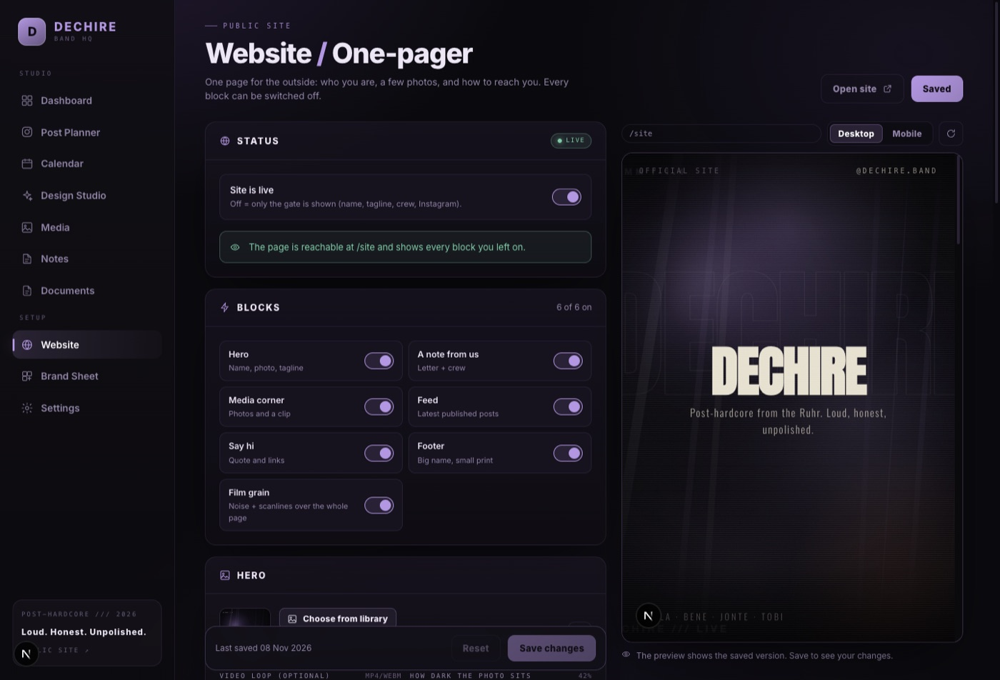

# déchire · Band HQ

**Two things in one repo:** an internal workspace for everything a band needs around social media and
paperwork — and a small public one-pager that is configured from inside it.

| | |
|---|---|
| **Band HQ** (internal) | Post planner with a real Instagram mockup, Canva-style design studio, media library with asset versions, notes, milestone calendar, documents (rider, contracts, orga), release waves, a beat-synced reel machine, exportable brand sheet, palette/CI editor |
| **Public site** (`/site`) | A cinematic one-pager that reads like a letter: hero, "a note from us", a media corner, the feed, contact links. Every block can be switched off in `/website` |



Everything is local: **SQLite via the built-in `node:sqlite`** (no database server, no native dependencies),
uploads on disk, no cloud, no external services. Warm black, bone, ash grey and one pale sulfur
signal – almost no colour. Emotional post-hardcore from Augsburg.

---

## Quick start

Requires **Node.js 24+** (`node:sqlite` is used without a flag; on Node 22 start with
`NODE_OPTIONS=--experimental-sqlite`).

```bash
npm install
npm run dev          # → http://localhost:3000
```

On first start the app creates `data/band.db` and fills it with demo content: 13 assets in 6 groups, 9 posts,
4 notes, 7 milestones, 4 documents, a band profile and a pre-filled public site.

```bash
npm run build        # production build
npm start            # serve the build (PORT is respected)
npm run typecheck    # tsc --noEmit
```

> **The workspace has a login mask at `/login`.** It contains the Instagram token and everything else in
> `data/`. On a server, set `HQ_PASSWORD` (see [deployment](docs/DEPLOY.md)) — then every internal page
> redirects to the mask and only `/site` stays public. Locally it is off, because the variable is empty.

---

## A look inside

| A note from us | The media corner |
| --- | --- |
|  |  |



---

## Interface

**Black paper, one accent, print marks.** The workspace runs on `#050508` plus the accent chosen in Settings –
no second hue in the chrome, no drop shadows. Contrast comes from hairlines, type and space.
`styles/shell.css` is loaded last and restates the shell plus every shared component, so page styles never fight it.

- **Display voice**: page titles in the serif voice (Redaction), lowercase and roomy; micro labels in
  Instrument Sans or DM Mono with wide tracking and a `///` accent tick. Dashboard figures use the same face, so
  numbers read like a poster, not a BI tool.
- **Shell**: a 246 px sidebar with numbered entries (`01 … 11`), grouped by `/// STUDIO` / `/// SETUP`, a quick-jump
  field that forwards `⌘K` to the command palette, and a slim sticky **context bar** on every page
  (`déchire /// MEDIA` · date · `⌘K`). Content is capped at 1560 px and centred; a 2 px accent strip sits at the
  very top of the app.
- **Components**: buttons, inputs, panels, badges, tables, empty states, modals and toasts share one language –
  2–3 px radii, 1 px hairlines, accent focus ring, a crop-mark corner on panels, mono uppercase labels.
- Below 1080 px the sidebar becomes a horizontal icon bar with the accent underline on the active entry, and the
  sticky panels get their height maths corrected for the context bar (`--ctx-h`).

---

## The tools

### 1. Post planner (`/planner`)
- **Real-time Instagram mockup**: profile grid and a single-post view. **Click a tile → that post opens in the
  single post view** (and in the editor), **drag a tile → it moves in the grid** (the drop target is highlighted),
  prev/next, carousel, likes, caption folding like the real app, plus a **1:1 grid-crop toggle**
  that shows how the tile will be cropped.
- **Editor split into three tabs** – Content, Publish, Insights – with a **readiness row** on top:
  media, caption, hook, alt text, hashtags and date, each a click away, and a clear
  “Ready to schedule” state.
- **Caption craft**: live character meter with the 125-character fold marker, **Unicode text styles**
  (bold, script, outline, small caps, wide, circled, spaced, upside down …) that work on the selection
  or the whole caption and can be turned back into plain text, structural helpers (rules, bullets),
  hashtag counter for the first comment and “use asset alt text”.
- **Create posts**: media (single or carousel with order), caption with a 2,200-character counter,
  first comment, song + artist, location, alt text, date (**quick presets**), format, status.
- **Drafts first**: a draft needs neither media nor a date and is never published — “Save as draft” writes it as a
  draft even if the post was scheduled before, and a date on a draft is just a note until you switch the status
  to *Scheduled* yourself.
- **Snippets**: saved hashtag sets, captions and hooks drop into caption or first comment with one click.
- **Performance per post**: publish to Instagram, sync insights or type the numbers in by hand.
- **Duplicate** a post as a new draft, **reorder the feed by drag & drop** (in the grid or in the *Feed order*
  list on the right — both call the same endpoint), sort by date, `⌘S` saves.
- **Export**:
  - `Feed as PNG` – snapshot of the mockup (2× resolution) for band chat decisions.
  - `Plan as ZIP` – the whole plan (see below).
  - One ZIP per post with images in upload order, `caption.txt`, `post.json` and `README.txt` with step-by-step instructions.

### 2. Design studio / post builder (`/studio`)
- **Canva feel without the cloud**: canvas with selection frame, 8 resize handles, rotation handle,
  smart snapping to edges, centre and other elements (with guide lines).
- **Tools**:
  - **Text** in 6 presets (Display, Headline, Label, Quote, Body, Meta) with **three fonts only**:
    Redaction (voice), Instrument Sans (body) and DM Mono (meta). Weight, size, tracking, line height,
    alignment, uppercase, italic, outline, shadow effects and text background stay available. Redaction is a
    xeroxed display serif; Instrument Sans is a quieter humanist grotesque than Inter; DM Mono is an editorial
    mono rather than a developer one. All three are OFL and local.
  - **Shapes**: rectangle, circle, triangle, diamond, star, burst, cross, slash, line, frame, tape –
    with solid fill, gradient (adjustable angle), stroke and corner radius.
  - **Media**: images from the library or direct upload, with fill/fit,
    grayscale, contrast, brightness, saturation, tint and corner radius.
  - **Extras**: 10 stickers (asterisk, spark, bolt, arrow, X, brackets, dots, wave, heart, circle)
    and 6 textures (grain, halftone, scanlines, stripes, grid, vignette) with blend modes.
  - **Layers**: list with visibility, lock, order and delete.
- **12 templates, all grey, dark and quiet**: *Release* (serif type instead of a poster shout), *Show* (date +
  city, thin frame), *Quote* (song line, two hairlines), *Merch* (type only), *Story* (out now),
  *Statement* (Redaction, no texture), *Portrait* (photo, desaturated grade, lowercase wordmark),
  *Close* (full-bleed portrait, whisper), *Note* (one note, no tape), *Elegy* (almost empty black),
  *Noise* (type running off the edges) and *Dates* (Augsburg, Munich, Stuttgart …).
  Templates are drawn in the CI placeholder and are **re-coloured to the live accent** on the way in
  (`recolourDesign()` in `lib/studio.ts`) – change the accent in Settings and every new design, every preview
  and every existing design (via *Directions → Brand accent*) follows.
- **Three fonts, all self-hosted**: **Redaction** (the voice – headlines, lyrics, quotes; OFL, vendored
  in `public/fonts`),
  **Instrument Sans** (body, captions, UI) and **DM Mono** (meta, labels, dates). No font carousel: everything in the
  studio, the documents, the reels and the public site uses this set.
- **Free photos in the studio** (`Stock` tab): search **Openverse** (WordPress/Automattic) filtered to
  **CC0 / public domain only** – usable commercially, **no credit and no payment**. Clicking a result downloads
  the file server-side (`/api/stock/import`), stores it in the media library with `stock`, licence and provider
  tags and drops it onto the canvas. Local copies matter: the canvas export needs same-origin images, and the
  design keeps working when the provider is offline.
- **Free clips in the reel editor** (`Clips wählen → Stock videos`): search **Pexels** when `PEXELS_API_KEY` is
  set (free commercial licence, no credit needed); without a key it falls back to **Wikimedia Commons**, filtered
  to CC0, public domain or plain CC BY and 2–30 s. The chosen clip is downloaded into `data/uploads`
  (`/api/stock/videos/import`), with author, provider and licence stored with it – ready for the ffmpeg cut.
- **Directions**: six one-click takes on the current canvas – *Paper* (light flyer stock, ink type),
  *Deep* (blacker, hotter glow), *Mono* (no colour, all texture), *Tilt* (everything a few degrees off the
  grid), *Outline* (hollow display type) and *Brand accent* (pulls every CI placeholder colour onto your current accent).
  Each direction is a full design, so applying one is a single undoable step; the grid shows live previews.
- **Formats**: feed 1:1, feed 4:5, story 9:16 – including “fit elements to format” and a **“3 sizes” export**
  that renders 1080×1080, 1080×1350 and 1080×1920 and packages all three PNGs into one ZIP
  (small store-only ZIP writer in `lib/zipStore.ts`, no extra dependency).
- **Google Fonts, self-hosted**: search all ~1,900 families in the inspector; a font is downloaded **once** onto
  your server (`data/fonts/`, latin + latin-ext, up to three weights) and served from your own origin. No
  requests to Google while working, exports keep the typeface, and the families show up in the font picker
  next to the nine built-in ones.
- **Export**: PNG at 2× resolution, save “to library” or drop it into the planner as a
  **draft post** with one click (PNG → media → draft). Plus *3 sizes* as a ZIP for feed and story in one go.

### 3. Media library (`/media`)
- **Folders** (`media_folders`, nestable): a rail on the left holds *All files*, *Unfiled* and the folder tree with
  rolled-up counts. Create, rename and delete folders; deleting one moves its files and subfolders one level up.
  A folder cannot be moved into itself.
- **Drag & drop** an asset onto a folder (rail row or folder card) to move it; dropping onto *All files* files it
  back to *Unfiled*. Uploads land in the folder you have open. Any file can also be re-filed from its detail dialog
  (`Folder` select, indented tree).
- Upload via button or **drag & drop** onto the window, images and videos.
- **Asset groups = versions**: a logo exists as “White/transparent”, “Smoke”, “Sticker 1080×1080”,
  “Social avatar” and so on. Every version downloads on its own (`?download=1`) or via “download version” in the group dialog.
- Search across title, version, tags and filename; filter by images / logos / video.
- Detail dialog: title, version label, group, tags, alt text, dimensions, size, **where the asset is used**
  (click to open the post) and **replace file** – swap the file, every post keeps the reference.
- Keeps track of how many posts an asset appears in (usage tracking).

### 4. Notes (`/notes`)
- Rich-text editor (TipTap): H1–H3, bold/italic/underline/strike, highlight, lists,
  **checklists**, quotes, code, links, alignment, undo/redo.
- Folders + tags, pinning, search, autosave (800 ms) with a status indicator, `⌘/Ctrl + S` saves immediately.
- Exported as clean HTML files in the full ZIP.

### 5. Calendar (`/calendar`)
- Month grid with **feed posts and milestones on one timeline**: scheduled and published posts, releases, shows,
  print deadlines, meetings, content slots. Posts and milestones can be toggled separately.
- Click a day to select it, double-click (or “Add milestone”) to create an entry, click an entry to edit it,
  click a post to jump straight to it in the planner.
- Milestones have a title, date, type, note, a “done” flag and a **checklist** (with a ready-made release checklist).
- `.ics` export for Apple/Google Calendar and an optional browser reminder (30 minutes before a post,
  on the day of a milestone).

### 6. Documents (`/docs`)
- Word-style editor for the paperwork: **technical rider, booking confirmations, itineraries,
  press texts, stage plot notes, lyrics** – with headings, lists, checklists, quotes, tables and links.
- Templates for every document type, drawn up in the band’s own wording (line-up, channel list,
  monitoring, backline, hospitality).
- **Lyrics**: one sheet per song (title = song title, tags for album/era). The lyric sheet has its own
  tighter line rhythm and **real song parts** instead of plain headings: every verse, chorus, bridge … is a
  block with a numbered label, its own colour-coded spine (chorus = accent, pre-chorus/bridge = second
  accent, intro/outro dotted, breakdown/solo black) and an optional repeat tag (`×2`, half-time …).
- **Part bar**: one click inserts the next part at the cursor and numbers it (`Verse 1`, `Chorus 2` …).
  Click into a part and a second bar appears: change the type, rename it, tag it, jump out with **End part**
  or dissolve it with **Unwrap**. Old sheets built from headings get a **Convert headings** button.
- **Structure map**: above the sheet a setlist-style rail lists every part in order with its repeat tag.
  Click a part to jump to it, use the arrows to swap neighbouring parts. Printed/exported sheets keep the
  same labels, spines and repeat tags – the labels are attributes, not text, so they never end up in a
  copy-paste of the lyrics.
- **Demos inside the document** (`document_audio`): attach any MP3/WAV/M4A from the media library
  (upload included). Tracks get a name, a size, a play button and can be detached again. Playback runs in a
  **docked player** at the bottom right, so it keeps playing while you scroll through the lyrics; it moves
  to the next demo on its own. The printed sheet lists the demos, the HTML export embeds them.
- Tables are real tables: insert, add/remove rows and columns, delete.
- **CI layout**: every document is rendered as a branded sheet – not a business letter. Dark masthead with
  logo, wordmark in the display face, tagline and a mono meta row (`type · No. · date · handle`); below it
  bone paper with `///` kicker, uppercase display title,
  two-tone accent rule, uppercase section headings with accent ticks, tables with night headers, and a footer
  line. Everything is driven by `--accent` / `--accent-2`, so the sheet follows the accent you pick.
- **Sheet image** (Settings → Document sheet): pick any photo from the media library – it sits in the dark
  masthead behind the wordmark. Strength is adjustable (0–60 %, default 30 %) and saved with the profile,
  so screen, print and HTML export stay identical. Without an image the masthead stays plain black.
- **Emoji picker** in the toolbar: band, mood, orga, road and faces – plus your last ten picks (stored
  locally). Inserts at the cursor position.
- **Images**: the picture button opens the media library (or uploads straight into it) and drops the chosen
  picture into the text. Click an image and a small Image bar appears: size 20–100 % and placement
  `left / center / right / full`. Left and right float, so text wraps around the picture – exactly the way a
  rider or a stage plot reads best. Size and placement live in `data-width` / `data-align`, which means they
  survive autosave, the HTML export and the PDF print.
- **Icons**: 124 hand-picked **Font Awesome Free (Solid)** icons – band, mood, on the road, orga, promo,
  marks – searchable, with recents. They are inserted as **inline SVG** (not a webfont), take the accent
  colour and stay self-contained in the exported HTML. Licence: icons CC BY 4.0, fonts OFL 1.1, code MIT.
- **Folders** for order: create, rename and delete in the sidebar, drag a document onto a folder (or pick
  the folder in the editor). Folder, search and type filters stack; deleting a folder keeps its documents
  and moves them back to *No folder*.
- Autosave (900 ms), tags, search and type filter.
- **Share links**: *Share* creates a random token and a public page at `/share/<token>` that shows only
  this document – no sidebar, no login, `noindex`. Attached demos are playable and downloadable there.
  *New link* rotates the token (the old URL dies immediately), *Stop sharing* removes it; shared
  documents carry a link icon in the list.
- Export as **print-ready PDF** (print stylesheet, only the sheet on paper) or as a standalone HTML
  file with the same layout – logo, sheet image, **every picture in the text** and demos up to 24 MB are
  inlined as data URLs, the accent is copied as a CSS variable, so the exported file works offline and in
  the band's current colours.

### 7. Colour lab (`/palette`)
The band's palette is not guessed any more – it is searched. Everything runs in **OKLCH**, so “pastel”,
“muted” or “a sibling of our smoke” are numbers instead of vibes (`lib/colorlab.ts`).

- **Guided search**: type what you mean – `pastel purple`, `muted moss`, `warm rust`,
  `complement of smoke` – and the query is parsed into hue family + mood + harmony. Chips for
  mood (pastel, muted, dark, bright, neon, earthy, vintage) and harmony (analogous, complementary,
  split, triad, tetrad, mono), plus lightness/chroma sliders when you want to drive it yourself.
- **Scoring**: every candidate is ranked against the palette you already have – hue relationship to the
  nearest colour, lightness separation and contrast to the darkest tone. Each card shows the score bar
  and a note (*sibling of Sulfur*, *counterpoint to Moss*, *exact name match*).
- **Tints & shades**: one click turns the seed into a paper→pastel→soft→base→deep→night ladder.
- **Generate a set**: builds night, ink, dusk, primary, accent, bone and signal from the seed.
- **Working palette** with role dropdowns, live preview (headline, button, chip, contrast readout) and a
  “set as UI accent” action on every swatch. Nothing is stored until you save – the module writes to the
  same `palette` table and `profile.accent_hex` as the settings page.

### 8. Brand sheet (`/brand`)
- One page CI guide generated from the live profile and palette: logo on night and bone,
  all colours with hex and role, the four typefaces with specimens, do/don’t rules.
- Export as **PNG (2×)**, as **SVG** (self-contained, fonts embedded) or print it as PDF.
- Change a colour in the settings and the sheet follows – no separate design file to maintain.

### 9. Instagram & performance (`/planner`, Settings)
- Publishing and insights through the **Meta Graph API** (single image and carousel), insights sync
  writes reach/likes/comments/saves/shares per post, the dashboard shows totals, average reach and
  the best weekday from your own numbers.
- Needs an Instagram business account, a Meta app with `instagram_content_publish` and
  `instagram_manage_insights` (app review) and **publicly reachable media URLs** – Instagram downloads the
  image itself, so localhost cannot work; set a tunnel/domain as “public base URL”.
- Without credentials everything runs in **sandbox mode**: same buttons, simulated ids and numbers,
  clearly labelled. Stories cannot be published through the API – use the ZIP export there.
- **Auto-publish**: scheduled posts go out on their own when their time has come. A heartbeat checks every
  minute while Band HQ is open in a tab; an external cron can call `POST /api/scheduler` instead. Needs live
  mode (sandbox only runs when you press “Run now”), logs every run in the settings and stores the last error
  per post. Stories are skipped with a hint towards the ZIP export.
- Manual numbers can be entered per post as well (reach, likes, comments, saves, shares).

### 10. Public website (`/site`) + configuration (`/website`)
**Warm black, one accent colour, photos taped to the wall.** No template furniture and nothing that reads
as a screen: no paper sheet, no stamps, no badges, no scanlines, no mono labels, no cursor effects.

- **Hero** – the band name in the display face, letter by letter out of the dark, with a soft second print
  underneath it (wet ink, not neon). Beside it **one photo as a taped print**, the tagline in serif italic,
  `@handle` and a quiet `read the note ↓`. Nothing else.
- **A note from us** – the letter itself: `Redaction` body on black, 54 ch, 1.7 leading, `*word*` marked with
  the accent, italic signature. Right beside it the band's photos as taped prints (paper, tape strip, own
  angle, grayscale that develops into colour on hover). No crew list, no roles, no names.
- **From the feed** – the same taped-print language as a wall of flyers, made from published posts.
- **Say hi** – one large press line in serif italic, next to the links set in the display face (Instagram,
  Bandcamp, Booking) – no numbering, no receipt.
- **Footer** – the band name as a very dark, solid field of type.
- **One accent only**: `--site-accent` is the single highlight colour; everything else is black, bone and
  photo paper. Labels are serif italic, not monospaced.
- **Blocks**, each switchable in the backend: hero, note, photos, feed, connect, footer.
- **Pre-launch mode**: switch the site off and visitors only see the gate — name, tagline, `nothing to see
  yet.`, Instagram. `noindex` until it is switched on. No countdown by design.
- **Configured in the backend** (`/website`) with a **live preview** next to the form (desktop/mobile):
  publish on/off, block switches, hero media, the letter, the signature line, photo picker, teaser link,
  tagline, labels, link list, footer note, meta description and the site's own accent colour.
- It reuses the rest of the app: the photos come from the **media library**, the flyers are made of
  **published posts**, and the accent runs through the same token system as the UI.
- **Room tone** (`components/site/SiteSound.tsx`): a quiet low drone plus tape hiss, synthesised with WebAudio –
  no audio file, no autoplay, off by default. The button fades the room in over ~2 s and remembers the choice.
- **Release band**: the release closest to today (from the release wave module) appears as a taped cover with
  `out now` / `out 13 nov`, one line and a pre-save or listen link. The site stays alive without anyone
  touching it on release day.
- **Interlude**: one full-bleed photo between letter and feed, the tagline in large serif italic, hairline above,
  slow zoom while it scrolls past (scroll-driven animation, only where supported).
- **Editorial rhythm**: chapter marks `01 / 02 / 03` in the left margin, a serif drop cap on the letter,
  `text-wrap: pretty`, hanging punctuation, taped prints that lift on hover.
- **Depth**: the hero breathes (34 s scale) and sinks away as you scroll; reveals stay slow and short.
  Everything in this list is skipped when `prefers-reduced-motion` is set.
- **Reduced motion** is respected: the letter rise, the scroll arrow and the grain stop.

### Dashboard (`/`)
Deliberately small – only what moves the band forward:

- **Coming up** – one chronological timeline of scheduled posts *and* dated milestones (with thumbnail,
  status, relative day and open-checklist count). Answers “what is next”, not “what exists”.
- **Needs you** – rule-based to-dos from the live data: drafts without a visual or caption, posts that go
  live within three days without media, milestones with open tasks in the next three weeks. Sorted by urgency.
- **Performance** – reach total, average reach, best weekday and the last published post (your own numbers).
- **Shortcuts** – documents, studio, notes, website – plus the band’s base figures in the panel header.

No feed preview, no media/notes counters, no wall of tiles.

### Settings (`/settings`)
Band profile (name, handle, bio, website, followers, highlights, avatar from the library) –
feeding straight into the Instagram preview. Plus the **interface accent colour** (primary + optional
secondary), the **document sheet image**, the **Instagram connection**, **backup & restore**, the **bin**,
the **CI palette editor** and two ways to start over: **remove all demo data** (empties posts, media files,
notes, milestones, documents, snippets, numbers and the bin, leaves designs/website/palette/fonts alone and
does not come back) or **reset** (wipe + demo data again).

### Backup, bin & search
- **Backup** downloads a ZIP with a consistent database copy, every upload and a manifest; **restore** imports
  it again (rows are imported instead of swapping files, so no restart is needed).
- Deleted posts, documents, milestones and notes land in the **bin** first and can be restored.
- **⌘K / Ctrl+K** opens a command palette that searches posts, assets, notes, documents, milestones,
  designs and snippets and jumps straight there.

### CI palette “Ash / Sulfur”
The band colours live in the database (`palette`) and are managed through `/api/palette`.
In settings you can change name, hex value, role and order, add new colours
and restore the defaults. Every colour picker in the design studio shows the CI as its own
row “Band CI” above the neutral tones – with names as tooltips.

| Name | Hex | Role |
| --- | --- | --- |
| Night | `#080808` | Base |
| Soot | `#111010` | Base |
| Ash | `#1a1918` | Deep |
| Umbra | `#262422` | Deep |
| Sulfur | `#e2e29c` | Primary |
| Smoke | `#a49c92` | Neutral |
| Steel | `#6f6a64` | Neutral |
| Bone | `#e7e0d6` | Paper |
| Rust | `#553b34` | Warm (print only) |
| Wound | `#43282b` | Signal (print only) |
| Moss | `#474b44` | Calm |

The accent is washed-out acid yellow, not pastel pink: a signal that is unusual enough to
be recognised, but never bright enough to shout. Rust and wound only appear in printed
artwork – the screen keeps one strange light.

### Interface accent colour

The UI accent (buttons, active navigation, focus rings, chips) is stored as `profile.accent_hex`
and derived into every token the design system needs (`--accent`, `--accent-rgb`, `--accent-2`,
`--accent-2-rgb`, `--accent-2-deep`, `--accent-deep`, `--accent-soft`, `--accent-glow`, `--line`,
`--line-strong`, `--shadow-accent`).
The layout renders it server-side so there is no flash, and the settings page applies it instantly
while picking (`accent:updated` event). Pick a CI colour, any hex, or jump back to the CI primary.

**Second colour (optional):** `profile.accent_2_hex` sets `--accent-2` – a working colour, not a gradient
partner. It carries the *information* layer of the UI while the primary carries interaction:

| Primary accent (`--accent`) | Secondary accent (`--accent-2`) |
| --- | --- |
| buttons, active navigation, focus rings, slider tracks, primary markers | page kickers (`.eyebrow`), panel-title icons, `scheduled` badges, meta labels, the document kicker, milestone dates in the timeline, text selection, ghost-button hover, `.chip.secondary` |

Leave it on *Auto* and the second tone is a sibling of the primary (hue +26°, slightly lighter, a bit
less chroma) – recognisably its own colour, still in the family. The Ash/Sulfur CI sets it to a muted
olive `#8f8f6a` on purpose, so sulfur stays the only signal. Pick a CI colour and it takes over
everywhere at once (also possible from the colour lab with the `2nd` button on any swatch). Nothing in
the app hardcodes an accent value any more – every translucent surface uses
`rgb(var(--accent-rgb) / x)` or `rgb(var(--accent-2-rgb) / x)`, so notes, studio, planner, media,
documents, dashboard and the brand sheet all follow the two colours you pick.

---

### 11. Release wave (`/releases`)
The module that plans a release with you instead of just storing a date. You enter title, format and
release day – everything else is derived from it.

- **Six phases**, all relative to the release date: *Produktion* (T‑56…T‑29), *Tease* (T‑28…T‑15),
  *Ankündigung* (T‑14…T‑8), *Countdown* (T‑7…T‑1), *Release-Tag* (T0), *Nachbrenner* (T+1…T+21).
- **44 researched steps** from the playbook (`lib/release.ts`): master delivery, cover art, metadata &
  splits, GEMA, distributor, video treatment/storyboard/shoot/edit, press, pre-save, Spotify pitch,
  Musixmatch lyrics, Canvas, release day, content ID, shorts, reporting. Each step carries its offset,
  the module it belongs to, a sentence on *why* and — where a platform rule is quoted — a **source link**
  (Spotify for Artists, YouTube Help, Instagram, GEMA, IFPI). The sidebar lists all 13 sources.
- **Every step is editable**: add your own (title, phase, due date, module, note, source, critical flag,
  optional media slot), edit any playbook step for this release, delete steps, and restore missing playbook
  steps with one click. Moving the release re-times all due dates from the offsets.
- **The result at the top**: as soon as a cover and a master are attached, the release renders as a
  playable single card — cover, title, custom audio player with seek/time, asset status (cover, master,
  video, pre-save) and the task progress. Missing pieces are one click away (media picker filtered to
  image / audio / video). Attaching the cover/master at the top fills the matching step too — and the
  other way round.
- **Steps are coupled to the modules**: planner steps create real drafts with a tailored caption
  (`{{title}}`, `{{band}}`, `{{date}}`, `{{presave}}`) at 18:00 on the due date; media steps attach an
  image/video/audio; document steps attach a press text, rider or **lyrics sheet** (deep link into
  `/docs?doc=…`); studio steps attach a design (deep link into `/studio/…`).
- **Music video plan included**: treatment, storyboard & shot list, shoot day, rights & credits, edit —
  with the real delivery specs (16:9 1920 × 1080, MP4/H.264 + AAC‑LC, separate 9:16 cutdowns, Canvas
  3–8 s, Reels ≥ 720 px/30 fps, Content ID via distributor).
- **Calendar integration**: *Kalender* writes announcement, pitch deadline, release and follow-up wave
  into the milestone calendar (idempotent – running it twice creates nothing new).
- **Readiness score** in the hero: overall percentage, open critical steps (announcement, pre-save,
  pitches, out-now), per-phase bars and the next four steps.
- **Spielregeln** with sources: Friday 00:01 local (Global Release Day), pitch ≥ 7 days before release
  (Release Radar), cover 1:1/3000 px/sRGB, master FLAC/WAV 44.1 kHz+/24-bit, Canvas 3–8 s, lyrics via
  Musixmatch, Reels specs, Content ID needs rights — and the honest note that pitching never guarantees
  playlist placement. Steps in a short lead time are flagged: a full new release wants ~8 weeks.

### 12. Press kit (`/brand` → *Press kit .zip*)
One click builds a ZIP for promoters, blogs and playlist editors:
`index.html` (clickable overview with photos and documents), `README.txt`, `bio-short.txt`,
`bio-long.txt`, `links.txt`, `press-photos/`, `logos/` and `documents/` – rider, stage plot, booking and
press text rendered as printable HTML pages in the CI accent. Everything is generated from the profile,
the media library and the document module, so the kit is never out of date.

### 13. Reel Lab (`/reels`)
The mini reel machine: clips from the library, one song, three steps, one MP4.
- **Presets** – Still 8 s, Slow 15 s, Grain 20 s, Long 30 s. Each one sets length, grade, grain,
vignette and motion in a click – warm or black and white, no strobe.
- **Clips** – 1–12 videos or photos, reorderable, each with a trim offset and a motion
(*still / push / pull*). Videos are cropped to 9:16 (`force_original_aspect_ratio=increase,crop`), photos
get a Ken Burns move through `zoompan`.
- **Beat cuts** – the track is decoded in the browser: RMS envelope → onset flux → autocorrelation → BPM,
phase search → beat grid, 2 s loudness jump → drop. Cuts snap to that grid and the drop becomes the
default start. No strobe, no zoom punch – the cut is the effect.
- **Text layer** – kicker, hook (1–3 lines, auto-sized), sub line and handle; Serif/Sans/Mono,
left/centre, top/middle/low. It is laid out inside Meta's safe zones (top 14 %, bottom 35 %, 6 % sides)
and rasterised to a transparent 1080×1920 PNG with `html-to-image` – what you see is the ffmpeg overlay.
- **Lyrics in time** – paste one line per cue, start a tap session and hit Space when each line begins;
  or set/nudge every cue against the playhead. The cue list shows a mini timeline with the playhead,
  `+ Zeile` appends a line and *Weich einblenden* fades each cue in over 0.22 s. The preview switches
  lyrics with the song, and the export rasterises one transparent PNG per cue and overlays it with
  `enable='between(t,…)'`. While lyrics exist they replace the hook; the kicker/sub/handle stay available
  as the quiet frame around them.
- **Preview** – the real 9:16 frame, scaled: media layers switch at the cuts, the song plays in sync,
  safe-zone guides and the live text sit on top. *Groß* opens a full-screen theatre with a scrubber,
  single-frame steps, an optional safe-zone overlay and *Als Cover* – good for checking a frame before
  trusting the export. Grain, vignette and grade are approximated in CSS.
- **Look** – four grades with a one-line explanation: *Neutral*, *Ember* (the house default: desaturated,
  slightly warm shadows), *Mono* and *Bleach* (pulled colour, high contrast). *Rahmen* switches between
  full 9:16 and a 4:3/16:9 film window with black bars; *Wortmarke* adds the small `déchire` with its sulfur é
  top right. Grain, vignette and fade-out as before. Beat flash is gone; the cut is the effect. The
  **cover frame** is set from the playhead (or stays at the default 0.6 s) so the feed thumbnail is a
  deliberate image, not a random frame.
- **Export** – `POST /api/reels` validates the plan and renders in a background job with progress:
  trim/crop/motion per clip, concat, grade, grain, vignette, frame bars, timed lyric PNGs, fade-out,
  `loudnorm I=-14`, then an **Instagram Reel delivery profile**: 1080×1920 @ 30 fps, H.264 High 4.2,
  yuv420p/4:2:0, BT.709, CRF 21 capped at **12 Mbps VBR** (`-maxrate 12M -bufsize 24M`), 2 s closed GOP
  (`-g 60 -keyint_min 60 -sc_threshold 0 -flags +cgop`), AAC 48 kHz stereo **128 kbps**, `+faststart`.
  That is well inside Meta's limits (max 25 Mbps, max 300 MB) and avoids the multi-hundred-MB files that
  `-crf 18 -tune grain` produced. The result screen shows the actual file size. A cover JPEG is grabbed from
  the result. Both appear in the media library, and *In den Planner* creates a reel draft with the hook as
  caption. Clips must be raster photos (PNG/JPG/WebP) or videos – SVG artwork has to be exported to PNG first.
  Needs **ffmpeg** on the server (`FFMPEG_PATH` if it lives outside `PATH`).

## Export format

`GET /api/export/plan` returns:

```
content-plan-2026-11-08.csv     Overview for Excel/Numbers/Sheets
posts/2026-11-13_scheduled_photo/
    01-tour-poster-halle-4-5-feed.svg
    caption.txt
    README.txt                  Upload guide incl. song & alt text
media/                          complete library, all versions
notes/*.html                    notes readable in the browser
README.txt
```

`GET /api/export/post/:id` returns the same post folder as its own ZIP.
The PNG snapshot of the feed is generated client-side via `html-to-image`.

---

## Stack

| Area | Choice |
| --- | --- |
| Framework | Next.js 16 (App Router, Turbopack, React 19, TypeScript) |
| Database | SQLite via the `node:sqlite` built into Node 22+ – **no native dependencies** |
| Files | `data/uploads/`, served through `/api/files/:filename` |
| Editor | TipTap 2 (StarterKit + Underline, Link, Highlight, TaskList, TextAlign, Placeholder) |
| ZIP export | `archiver` (v8) |
| Image dimensions | `image-size` |
| Design export | `html-to-image` (PNG snapshot of the canvas, 2× resolution) |
| Fonts | Redaction, Instrument Sans, DM Mono – three OFL families, all vendored in `public/fonts` |
| Styling | hand-written CSS design system in `styles/` (no Tailwind, no runtime) |

### Project structure

```
app/
  layout.tsx               Document shell (fonts, accent tokens)
  (hq)/layout.tsx          Workspace chrome: sidebar, command palette, toasts, scheduler
  (hq)/page.tsx            Dashboard
  (hq)/planner/page.tsx    Post planner
  (hq)/calendar/page.tsx   Milestone calendar
  (hq)/studio/page.tsx     Design studio (gallery + templates)
  (hq)/studio/[id]/page.tsx Design editor
  (hq)/palette/page.tsx    Colour lab (guided palette search, harmonies, generator)
  (hq)/media/page.tsx      Media library
  (hq)/notes/page.tsx      Notes
  (hq)/docs/page.tsx       Documents (rider, contracts, orga)
  (hq)/reels/page.tsx      Reel Lab – clips, beat cuts, text layer, ffmpeg export
  (hq)/website/page.tsx    Public site: blocks, letter, crew, media corner, live preview
  (hq)/brand/page.tsx      Brand sheet (CI guide, export)
  (hq)/settings/page.tsx   Profile, accent, Instagram, backup, bin, palette
  site/                    Public one-pager with its own layout (no sidebar)
  api/                     REST endpoints (posts, media, media-groups, notes, designs, palette,
                           milestones, documents, profile, stats, site, files, export/*, reset)
proxy.ts                   Login gate: /login + signed session cookie (active when HQ_PASSWORD is set)
server.js                  Startable Node server for Passenger / systemd
components/                InstagramMock, PostEditor, PostPerformance, SnippetMenu, MediaPicker,
                           NoteEditor, DocEditor, docNodes (image + icon nodes), EmojiPicker,
                           IconPicker, CommandPalette, UI primitives, icons
lib/docIcons.ts            Curated Font Awesome Free (Solid) set – inline SVG for documents
components/site/           Reveal, SiteAtmosphere (film layer of the public page)
components/studio/         Canvas renderer, editor, tool panel, inspector, gallery,
                           variants modal, font browser (Google Fonts) + useCustomFonts store
lib/studio.ts              Accent mapping, format adaptation, design directions
lib/zipStore.ts            Tiny browser ZIP writer (store only) for the multi-format export
app/api/stock/             Openverse photo search, Pexels/Commons video search + local import
lib/
  db.ts                    SQLite connection, schema, migrations, atomic seed
  repo.ts                  Queries & mappers
  seed.ts                  Demo content + generated SVG artwork
  site.ts                  Public site settings, blocks, crew and media corner data
  siteEmbed.ts             Teaser links → YouTube/Vimeo/Instagram/video embeds
  fonts.ts                 Google Fonts search, one-time download, @font-face CSS
  colorlab.ts              OKLCH colour maths: search, scoring, harmonies, generator, naming
  design.ts                Design model, shapes, fonts, textures, templates
  docTemplates.ts          Rider, contract, itinerary, press & stage-plot templates
  reels.ts                 Reel plan model, presets, beat-aware clip lengths, safe zones
  beats.ts                 RMS/flux beat tracking, drop detection, waveform peaks
  reelRender.ts            ffmpeg pipeline (crop, zoompan, grade, overlay, loudnorm, cover)
  reelJobs.ts              In-memory render jobs with progress for the polling UI
  instagram.ts             Meta Graph API client (publish, insights, token refresh, sandbox)
  backup.ts                Backup ZIP + restore by importing rows
  palette.ts               CI palette, accent tokens, colour helpers
  kinds.ts                 Document & milestone type labels
  exporters.ts             Caption/metadata/README/HTML export
  zip.ts, api.ts, format.ts, toast.ts, types.ts
styles/                    base, shell (UI system v2), dashboard, planner, media, notes,
                           settings, studio, palette, calendar, docs, brand, command,
                           website, site, login, fonts, reels
data/                      band.db + uploads (git-ignored, created on first start)
docs/KONZEPT.md            Product and architecture plan
docs/DEPLOY.md             Server setup: Plesk Node.js extension, systemd + nginx, cron, backups
```

### API quick reference

| Method | Route | Purpose |
| --- | --- | --- |
| GET/POST | `/api/posts` | List / create |
| GET/PATCH/DELETE | `/api/posts/:id` | Detail / update / delete |
| POST | `/api/posts/reorder` | `{ ids }` or `{ action: "sort-by-date" }` |
| GET/POST | `/api/media` | List / multipart upload (`files`) |
| GET/PATCH/DELETE | `/api/media/:id` | Detail / metadata / delete |
| GET/POST/PATCH/DELETE | `/api/media-groups` | Asset groups |
| GET/POST | `/api/notes`, `/api/notes/:id` | Notes |
| GET/POST | `/api/designs` | Design studio: list / create |
| GET/PATCH/DELETE | `/api/designs/:id` | Load / save / delete a design |
| GET/PUT | `/api/palette` | Read / fully replace the CI palette |
| GET/POST | `/api/milestones`, `/api/milestones/:id` | Calendar milestones (PATCH/DELETE on `:id`) |
| GET/POST | `/api/documents`, `/api/documents/:id` | Documents (PATCH/DELETE on `:id`) |
| GET/POST | `/api/doc-folders`, `/api/doc-folders/:id` | Document folders (PATCH/DELETE on `:id`) |
| POST/DELETE | `/api/documents/:id/share` | Create/rotate or revoke a public share token |
| GET/POST | `/api/snippets`, `/api/snippets/:id` | Caption, hashtag and hook snippets |
| POST | `/api/posts/:id/duplicate` | Copy a post as a new draft |
| GET/POST/DELETE | `/api/trash`, `/api/trash/:id` | Bin: list, restore (POST), delete for good |
| GET/POST | `/api/reels`, `/api/reels/:id` | Reel Lab capability + render job (poll `:id`) |
| GET/POST | `/api/metrics` | Manual numbers, best-weekday insight |
| GET/POST | `/api/instagram` | Status, save, test, publish, sync |
| GET/POST | `/api/scheduler` | Auto-publish status / run it (also for cron) |
| GET/PUT | `/api/site` | Public site settings, blocks, crew, media corner |
| GET/POST/DELETE | `/api/fonts`, `/api/fonts/:id` | Self-hosted Google Fonts (search: `/api/fonts/search?q=`) |
| POST | `/api/media/:id/replace` | Swap the file of an asset |
| GET | `/api/backup`, `POST /api/restore` | Backup ZIP / restore it |
| GET | `/api/export/calendar` | `.ics` calendar feed |
| GET | `/api/search?q=` | Global search for ⌘K |
| GET/PATCH | `/api/profile` | Band profile incl. accent colour |
| GET | `/api/stats` | Dashboard numbers |
| GET | `/api/files/:filename` | File (with `?download=1` as download) |
| GET | `/api/export/post/:id`, `/api/export/plan` | ZIP exports |

---

## Running it on a server

**Full walkthrough for IONOS/Plesk — both the Plesk Node.js extension and a systemd + nginx setup, including
permissions, the login mask, cron and troubleshooting: [`docs/DEPLOY.md`](docs/DEPLOY.md).**

It is a normal Node.js app with a file database — no Docker, no external services:

```bash
git clone https://github.com/rmue11er/dechire_band.git bandhq && cd bandhq
npm ci
npm run build
PORT=3000 npm start          # or: node server.js
```

Then put a reverse proxy in front of it and point the domain at the proxy:

```nginx
location / {
  proxy_pass http://127.0.0.1:3000;
  proxy_http_version 1.1;
  proxy_set_header Host $host;
  proxy_set_header X-Forwarded-Proto $scheme;
  proxy_set_header Upgrade $http_upgrade;
  proxy_set_header Connection "upgrade";
}
```

Things that actually matter:

- **`data/` must persist and be writable** by the app user — database, uploads, WAL files. Exclude it from
  deploys; that is the whole backup.
- **Node 24+** (or 22 with `NODE_OPTIONS=--experimental-sqlite`); build and runtime should use the same major.
- **Protect the workspace**: `/site` is public, everything else is not. Set `HQ_USER` + `HQ_PASSWORD` and the
  gate in `proxy.ts` locks every path except `/site`, `/_next`, `/api/files` and the icon.
- **Scheduler without an open tab**: cron every 5 minutes →
  `curl -fsS -X POST https://your.domain/api/scheduler`
- **Instagram publishing on the server**: set the public base URL in Settings to the real domain, because
  the Graph API fetches `/api/files/...` itself.
- **Backups**: either the button in Settings (ZIP with database + uploads) or
  `tar czf backup-$(date +%F).tgz data/` from cron.

---

## Notes

- All data lives in `data/` – back up the folder and you have a backup.
- Added Google Fonts live in `data/fonts/` (font files + a cached catalogue list) and in the `fonts` table; both
  are part of the folder backup. Adding a font needs outbound HTTPS to `fonts.google.com` once — after that
  the studio works offline.
- “Settings → Reset” deletes posts, media, notes, designs, milestones and documents, reseeds the demo
  data and restores the default accent + palette.
- “Settings → Remove all demo data” does the same wipe **without** restoring anything, so the app stays empty
  for real content. The band profile is kept (emptied) – otherwise the app would reseed itself on the next
  start, because it seeds whenever the profile is missing.
- The demo images are generated SVG artwork in the band look; just upload real photos/logos.
- The public page lives at `/site` and is meant to be put behind a real domain later; the workspace keeps
  `/`. Saved posts can still be published by the scheduler — the ZIP export stays the manual fallback.
- The SQLite connection never writes on connect (only when seeding an empty database), so the dev
  server does not rebuild itself in a loop while serving requests.
