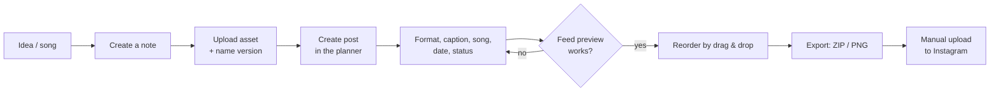
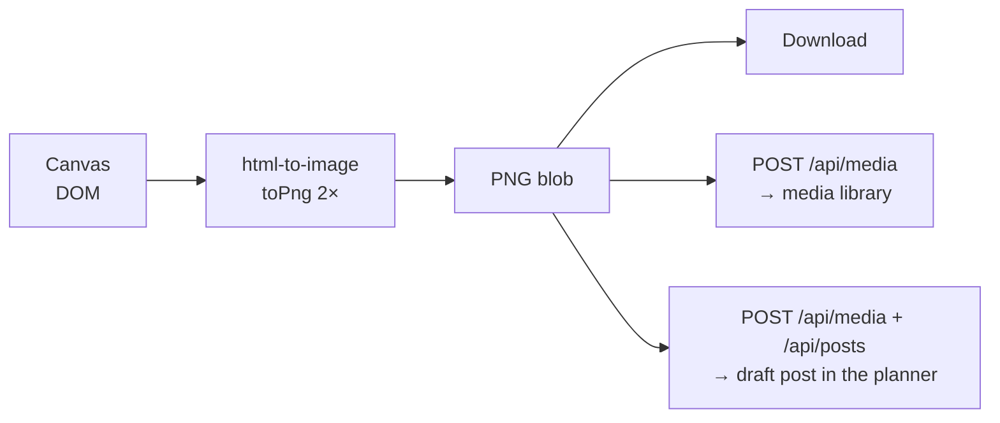
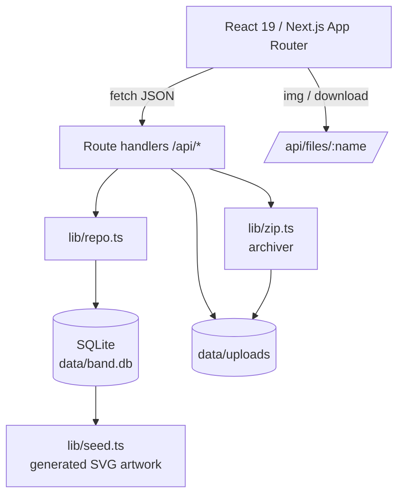

# déchire · Band HQ – Concept & implementation plan

Goal: a **local backend with a UI** where a post-hardcore band plans its social media
presence – no agency tool, no cloud lock-in, no monthly subscription.

---

## 1. Starting point & requirements

From the brief:

1. **Instagram post planner** – create posts with image, caption and song, plan the feed and see a
   *professional preview* of how the profile will look; export for the real upload.
2. **Media library** – all media organised; when the logo is needed somewhere,
   grab the right **version** (transparent, white, sticker, square …) straight away.
3. **Notes** – another tool with *solid formatting options*.
4. Colour world: warm black, soot and ash, one pale sulfur signal – a strange, washed-out
   acid yellow instead of pastel pink. Dark, heavy, but never cold-corporate. A hint of 80s/90s
   texture (grain, low light), never a costume.

Quality goals derived from that:

| Goal | Implementation |
| --- | --- |
| “Actually feels like Instagram” | Real phone mockup with status bar, profile header, highlights, grid, post view, carousel, song ticker |
| Plan instead of administer | Drag & drop order, status (draft/scheduled/published), dates, countdown |
| Fast path to upload | Per-post ZIP with images in order + caption + guide, full plan as ZIP, PNG snapshot |
| Find assets again | Groups (assets) + versions, tags, search, usage counter |
| Frictionless writing | WYSIWYG with shortcuts, autosave, folders, tags, pinning |
| Local & robust | SQLite in-process, files on disk, no external services |

Non-goals (deliberate): automatic publishing via the Instagram API, multi-user accounts,
cloud hosting, analytics reporting. Those are sketched as roadmap.

---

## 2. User flow



---

## 3. Tool 1 – Instagram post planner

### 3.1 Data fields of a post

| Field | Purpose |
| --- | --- |
| `type` | Photo, carousel, reel, story – drives aspect ratio and badges |
| `status` | Draft, scheduled, published |
| `caption` | Max. 2,200 characters, the counter warns |
| `firstComment` | Hashtags/ticket link – kept separate, the way professionals do it |
| `media[]` | One asset or several in a defined order (carousel) |
| `songTitle` / `songArtist` | Instagram music tag, shown as a ticker in the mockup |
| `location` | Place in the post header |
| `altText` | Accessibility, ends up in the export |
| `scheduledAt` / `publishedAt` | Planning & history |
| `position` | Explicit feed order (drag & drop) |

### 3.2 Preview

- **Profile view**: avatar, posts, followers/following, bio, link, highlights, grid.
  Tiles show carousel/reel badges and a status label (draft/scheduled) – planner only, not in the export
  snapshot. Every tile is a button: clicking it opens that post in the single-post view.
- **Single-post view**: header with avatar + location, 4:5 (9:16 for stories), carousel navigation with dots,
  likes, caption with the real “more” fold, first comment, song ticker, location, timestamp. Prev/next arrows
  walk through the queue; a **1:1 toggle** shows the grid crop, so 4:5 artwork can be judged the way the
  profile will show it.
- Likes/comments are derived deterministically from the post ID – the preview feels alive without inventing
  real data.
- Scrolls like a real phone, but without the tab bar in the post view (closer to the original).

### 3.2a Writing captions without friction

- **Readiness row**: media, caption, hook, alt text, hashtags and date as chips above the editor tabs;
  clicking a chip jumps to its block, “Ready to schedule” appears when the required ones are green.
- **Caption meter**: character count, a marker at 125 characters where Instagram folds the text, and a hint
  how much of the hook stays visible.
- **Unicode text styles** (`lib/textStyles.ts`): bold, italic, script, outline, mono, small caps, wide,
  circled, squared, spaced, upside down, strike, underline – applied to the selection or the whole caption,
  with undo and “back to plain text”. These are real Unicode characters, so Instagram, the ZIP export and
  print keep them; the tool warns that screen readers may stumble over them.
- **Structure helpers** (rules, dots, slashes, bullets, numbers) and saved **snippets** for hashtag sets,
  captions and hooks. Alt text can be taken over from the asset with one click.


### 3.3 Queue
- The list *is* the feed order (position 1 top left) — the number sits on the thumbnail, the row shows status, date
  and a hover-only grip/export so the list stays quiet.
- Dragging sets the position through the API, the preview updates optimistically right away. **The profile grid
  is a drop surface too**: dragging a tile onto another one is the most direct way to design a grid, and it calls
  the same endpoint. Clicking a tile opens that post in the single-post view *and* in the editor.
- Filter by status; “sort by date” orders chronologically.
- Each row has a direct ZIP download.

### 3.4 Export

Two levels: *per post* (what you actually upload to Instagram) and *full* (backup/handover).

- Naming scheme `01-<title>-<version>.ext` so the carousel order is unambiguous on upload.
- `caption.txt` with a clear “first comment” separator.
- `post.json` machine-readable (song, alt text, media dimensions).
- `README.txt` with a six-step guide including the song search.
- PNG snapshot of the preview for band decisions – rendered client-side with `html-to-image`.

---

## 4. Tool 2 – Media library

### 4.1 Model: asset vs. file

The problem in the brief – “when I use my logo somewhere, I want the version I need” –
is solved by a two-level model:

```
Asset group "déchire Wordmark"
├── Version "White / transparent"      1080×1080, SVG
├── Version "Smoke / transparent"   1080×1080, SVG
├── Version "Sticker 1080×1080"        1080×1080, SVG
└── Version "Social avatar"            1080×1080, SVG
```

- A group has a name + kind (logo/artwork/photo/merch/other).
- A file has a label, tags, alt text, dimensions, size, MIME and optionally a group.
- The group view shows stacked previews and the number of versions; a click opens the version list
  with “download version” and “details”.
- Usage counter: how many posts the file appears in (join over `post_media`).

### 4.2 Upload & organisation

- Multi-upload, drag & drop across the whole page, 80 MB limit per file.
- Dimensions are read server-side with `image-size` (including SVG, PNG, JPEG, WebP, AVIF).
- Editing happens in the detail dialog; deleting removes the DB row **and** the file.
- Logos are shown with `object-fit: contain` in previews, photos with `cover` – nothing gets cropped by accident.

### 4.3 Folders

Groups answer “which versions belong together”, folders answer “where does this live”. Both stay independent:
an asset can sit in `Live 2026 / München` *and* be part of the logo group.

- `media_folders(id, parent_id, name, created_at)` with `ON DELETE CASCADE` for the tree, `media.folder_id` added
  through `ensureColumn` so old databases migrate in place.
- `listFolders()` returns a flat list in tree order with `depth`, `count` (direct files) and `total`
  (rolled up from the leaves) – the rail renders it with `padding-left: 10 + depth * 14`.
- Deleting a folder is non-destructive: subfolders and files move one level up (`deleteFolder`).
  Moving a folder into its own subtree is refused (`updateFolder` walks the parents, API answers 409).
- Moving files: `POST /api/media/move { ids, folderId }` – one request serves single drags and multi-select,
  `folderId: null` means *Unfiled*. Uploads carry `folderId` in the multipart form.

---

## 5. Tool 3 – Notes

- TipTap 2 with StarterKit plus Underline, Link, Highlight, TaskList/TaskItem, TextAlign, Placeholder.
- Toolbar grouped (history · headings · characters · lists · blocks · alignment).
- Order: folders (free input with suggestions), tags, pinning, full-text search across title/body/tags.
- **Autosave**: every change (text *or* metadata) restarts an 800 ms timer;
  after saving it checks whether typing continued during the request – if so, it saves again.
  Status: *Unsaved / Saving … / Saved*. `⌘S` forces a save.
- Exported as a standalone, styled HTML file in the full ZIP.

---

## 6. Tool 4 – Design studio (post builder)

Goal: “as simple as Canva” – a blank sheet, a handful of tools, done is the Instagram image.
No account, no cloud, with immediate export into our own pipeline.

### 6.1 Why DOM instead of `<canvas>`

The canvas is **not** a `<canvas>` element but a DOM tree of absolutely positioned,
transformed nodes:

| Benefit | Why it matters |
| --- | --- |
| Text stays text | Inline editing with `contentEditable`, real web fonts, kerning by the browser |
| CSS effects for free | Gradients, `mix-blend-mode`, filters (grayscale, contrast), clip paths for stars/bursts |
| Scaling without re-implementation | The whole surface shrinks via `transform: scale(zoom)` – the layout stays identical |
| Export | `html-to-image` serialises the DOM node into an SVG and rasterises it – same look as the editor |

Limits (deliberate): no cut-outs/masks, no path editing tools, no layer groups.
That is roadmap, not v1.

### 6.2 Element model

Every element has a shared core and type-specific fields:

```
Base      { id, type, name, x, y, w, h, rotation, opacity, blendMode, locked, hidden }
Text      { text, fontFamily, fontSize, fontWeight, italic, uppercase, color, align,
            lineHeight, letterSpacing, outlineWidth, outlineColor, shadow,
            bgColor, bgPadding, bgRadius }
Shape     { shape, fillType, fill, gradientFrom, gradientTo, gradientAngle,
            strokeColor, strokeWidth, radius }
Image     { url, mediaId, fit, radius, grayscale, contrast, brightness,
            saturation, tintColor, tintOpacity }
Sticker   { glyph, color }
Texture   { texture, color, scale }
```

The order in the `elements` array **is** the layer order (back → front).
Everything is stored as JSON in the `designs` table – a design is therefore a
portable document, not a pile of pixels.

### 6.3 Tools

- **Text**: 6 presets, **three fonts** – Redaction (voice), Instrument Sans (body), DM Mono (meta).
  Size, weight, tracking, line height, alignment,
  uppercase, italic, outline, five shadow modes, text background as a “pill”.
- **Shapes**: rectangle, circle, triangle, diamond, star, burst, cross, slash, line, frame, tape.
  Solid or gradient with an angle, stroke, corner radius. Stars/bursts/cross/slash via `clip-path`
  (procedurally computed polygons), strokes as inset shadows – so they clip exactly at the edge.
- **Media**: library + upload directly in the panel; image filters and tint as a colour overlay with `mix-blend-mode: color`.
- **Extras**: 10 stickers as inline SVG (scale losslessly, `currentColor`) and 6 textures
  (grain via SVG turbulence, halftone, scanlines, stripes, grid, vignette) with blend modes.
- **Layers**: visibility, lock, move up/down, delete, selection – and in the inspector
  “bring to front/send to back”. Locked elements are not grabbable but still selectable.

### 6.4 Interaction

- **Move**: pointer-down on an element, the delta is divided by the zoom.
- **Resize**: 8 handles. The delta is rotated into local space with the element rotation,
  the size is changed there and the centre is shifted by half the size change (also rotated) –
  so the opposite edge stays put, even on rotated elements. `Shift` keeps the aspect ratio.
- **Rotate**: handle above the box, angle from `atan2` around the element centre, `Shift` snaps to 15° steps.
- **Snapping**: edges and centres of the canvas and all other elements, threshold 8 screen pixels
  (divided by zoom), hits are shown as a red guide line.
- **Keyboard**: `⌘Z` / `⇧⌘Z`, `⌘D` duplicate, `⌘S` save, `Del`, arrow keys (with `Shift` = 10 px),
  `Esc` to deselect. History is a snapshot stack (max. 100 steps), drags push exactly one entry.
- **Autosave**: 900 ms debounce on `/api/designs/:id`, status indicator *Unsaved → Saving → Saved*.

### 6.5 Templates & formats

- Formats: feed 1:1 (1080×1080), feed 4:5 (1080×1350), story 9:16 (1080×1920).
- 12 templates, all in the same quiet language: *Release*, *Show*, *Quote*, *Merch*, *Story*,
  *Statement*, *Portrait* plus *Close* (portrait, dark veil, whisper in Redaction italic),
  *Note* (date, lowercase), *Elegy* (empty black, serif, two hairlines), *Noise* (display type
  running off both edges) and *Dates* (plain rows, accent rules). Decorations were removed on purpose:
  serif instead of caps, no tape, no badges, no halftone, one accent.
- **Type voice**: Redaction, Instrument Sans, DM Mono – all three OFL and vendored in `public/fonts`. The presets *Display / Whisper / Elegy / Note / Type / Tight* encode the intent, so a
  design reads emotional before anyone touches a slider.

### 6.5a Free stock photos

`Stock` tab → `/api/stock/search` → **Openverse** (`openverse.org`, no API key) with
`license=cc0,pdm`, `category=photograph`, `size=large`, `filter_dead=true`. The filters are not cosmetic:
without them the index returns book scans, memes and 230 px thumbnails. Anonymous requests are capped at
20 results per page, so the route caches queries for 10 minutes.

Chosen photo → `/api/stock/import` downloads it **server-side**, writes it into `data/uploads` and registers a
media item tagged `stock`, licence and provider. Copying instead of hot-linking is deliberate: `html-to-image`
needs same-origin (or CORS) images, licensing stays traceable, and the design survives the provider going down.
CC0 means commercial use without credit or payment.
- **Templates follow the CI**: the older templates were drawn in the default CI placeholder. Instead of hard-coding
  an accent into seven builders, `recolourDesign()` maps every CI-ish colour onto the live accent when the
  template is applied (gallery preview included). Detection is `oklch`-based – hue within 16°, chroma above
  0.025 – so neutrals, bone paper and black veils are never touched; lightness *ratios* are preserved, which
  keeps light tints light and deep shades deep, alpha included.
- **Directions** (`lib/studio.ts` → `designVariants`): six one-click takes on the current design, shown as live
  previews and applied as one undoable history step – *Paper* (paper background, light type becomes ink, dark
  veils become paper, screen blends become multiply), *Deep* (near-black gradient, hotter accent glows),
  *Mono* (every accent hue mapped to paper/ink), *Tilt* (text alternating ±2°, shapes offset a few degrees),
  *Outline* (`color: transparent` + `WebkitTextStroke` on the two biggest text blocks) and *Brand accent*
  (the recolour above).
- “Fit elements to format” scales positions, sizes, font sizes and strokes proportionally
  (`adaptDesign()` – the same function the multi-format export uses).

### 6.5b Export set

One click renders the design in all three formats and zips them: `adaptDesign()` → set the hidden export
canvas → two `requestAnimationFrame`s → `toPng` → collect the bytes → `zipBlob()`. The ZIP writer
(`lib/zipStore.ts`) is 90 lines of store-only ZIP (local headers, central directory, end record, CRC-32 table)
– verified against `unzip -t` – so no extra dependency and no server round trip.

### 6.6 Export pipeline



Important: rendering captures a **separate, invisible 1:1 copy** of the canvas
(`position: fixed; left: -20000px` on the wrapper, the captured element itself without positioning) –
capturing the shifted element directly would put the content outside the image.
Web fonts are embedded from the stylesheets by `html-to-image`; that is why only the
**latin subsets** of the Fontsource packages are loaded.

### 6.7 Google Fonts (search, but self-hosted)

- The catalogue comes from Google's public metadata list (`fonts.google.com/metadata/fonts`, ~1,900 families),
  fetched by our own server, trimmed to what matters and cached in `data/fonts/metadata.json` for a week.
- Picking a family downloads it **once**: `css2?family=…` with a browser UA, keep `latin` + `latin-ext`, up to
  three weights (400/700 plus one light or black), store the `woff2` files next to the catalogue and keep the
  `unicode-range` from the original rules.
- Serving, not linking: `lib/fonts.ts` generates the `@font-face` rules with **our own** URLs
  (`/api/fonts/file/…`), the client injects them as a `<style>` tag. That keeps DSGVO out of the equation, works
  offline afterwards and — the reason for the whole detour — lets `html-to-image` embed the type on export.
- The registered families are merged into the studio's font registry (`registerFonts` in `lib/design.ts`), so
  the canvas resolves them by id exactly like the built-in nine. The list is a `useSyncExternalStore` snapshot,
  which is what makes canvases and previews re-render when a font arrives.
- Removing a font deletes the row and its files; “Reset” clears the table too but keeps the catalogue cache.

## 7. Tools 5–8 – calendar, documents, brand sheet & workflow

The first four tools cover the feed. These cover the rest of band life: dates, paperwork, CI and the
small things that otherwise get lost.

### 7.0 Calendar (`/calendar`)

- **One timeline for posts *and* milestones** – the planner queue answers “in which order”, the calendar
  answers “when”. Toggling posts/milestones keeps the grid readable; a counter shows how many days of the
  month actually carry a post (cadence, not just content).
- Milestones: title, date, type (`release`, `show`, `deadline`, `meeting`, `content`, `other`), note, done flag
  and a **checklist** – the release template fills in cover formats, teaser, story, poster, merch, press text.
- `.ics` export (`/api/export/calendar`) for phones and shared calendars; an opt-in browser reminder fires
  30 minutes before a scheduled post and on the day of a milestone.

### 7.1 Milestone calendar (`/calendar`)

- Month grid, Monday first, 42 cells (previous/next month dimmed, today highlighted).
- A milestone is deliberately small: title, date, type, note, done flag. Types are `release`, `show`,
  `deadline`, `meeting`, `content`, `other` – the type drives the chip colour.
- Interaction: click selects a day, double-click or “Add milestone” creates, clicking a chip edits it.
  The side column shows the selected day plus the next six upcoming entries.
- Why not a full calendar with posts? Posts already live in the planner queue with their own dates;
  the calendar answers “what has a date but no feed post” – print deadlines, calls, shoots.

### 7.2 Documents (`/docs`)

- TipTap again, but with the **table extension**: a technical rider without a channel list is useless.
- Templates in `lib/docTemplates.ts`: technical rider (line-up, contacts, channel list, monitoring,
  lighting, power, hospitality), booking confirmation, itinerary, press text, song lyrics, stage plot, blank.
- **Lyrics** are a document type of their own (`kind: 'lyrics'`): one sheet per song, tighter line
  rhythm (`styles/docs.css` → `.doc-page.lyrics`).
- **Song parts** are a real block node (`DocSection` in `components/docNodes.ts`):
  `<section class="doc-section" data-part="chorus" data-label="Chorus 2" data-tag="×2">`. The label and
  repeat tag are attributes rendered by CSS `::before`/`::after`, so they stay out of the lyric text and
  survive `getHTML()`, print and the HTML export identically. Kinds, auto-numbering and the heading guesser
  live in `lib/kinds.ts` (`LYRIC_PARTS`, `partLabel`, `isNumberedPart`, `guessPartKind`).
- Editor chrome for parts: the **part bar** (`LYRIC_PARTS` chips, inserts after the current block and numbers
  the next part), a **part tools bar** while the cursor is inside a part (type select with auto-relabel,
  label/tag inputs, ×2/×3 toggles, End part, Unwrap), and a **structure map** (jump-to-part via
  `setTextSelection(pos+2).scrollIntoView()`, neighbour swap via `tr.replaceWith` – only when the two parts
  are adjacent). A **Convert headings** action (`guessPartKind`) rebuilds old h2-based sheets with
  `setContent`, one undo step. The template in `lib/docTemplates.ts` ships the section markup directly.
- **Audio attachments** (`document_audio` in `lib/db.ts`): `document_id`, `media_id`, `label`, `position`.
  `POST /api/documents/:id/audio` attaches a file from the library (audio mime only),
  `PATCH|DELETE /api/document-audio/:id` renames or detaches it. `lib/repo.ts` exposes
  `listDocumentAudio` / `attachDocumentAudio` / `updateDocumentAudio` / `deleteDocumentAudio`;
  `BandDocument.audio` carries the resolved media rows. `components/DocAudio.tsx` renders the track list in
  the editor chrome and one shared `<audio>` element whose player is **fixed to the bottom right**, so demos
  keep playing while the lyrics scroll; it advances to the next track on `ended`. `/api/files/…` now answers
  **Range** requests (206) so seeking works. Deletes go into the bin payload and are re-attached on restore;
  backups and both reset modes include the table; the HTML export embeds demos up to 24 MB as data URLs.
- Same autosave pattern as notes (900 ms debounce, version counter, `⌘S`, dirty/saving/saved state).
- **Folders** (`doc_folders`): `documents.folder_id` references a folder, `GET|POST /api/doc-folders`
  lists and creates, `PATCH|DELETE /api/doc-folders/:id` renames and removes. Deleting a folder sets its
  documents back to `folder_id = NULL` – nothing is trashed with it. The sidebar in `app/(hq)/docs/page.tsx`
  shows counts per folder and acts as a drop target: `onDragStart` stores the document id, `onDrop` calls
  `moveDocument` (PATCH with `folderId`), and the editor offers the same move through its Folder select.
  Folder, search and type filters combine.
- **No draft/final status**: a document is a document. The old `status` column stays in existing databases
  (default `'draft'`) but is never read or written, and the sheet no longer prints a FINAL/DRAFT stamp.
- **Share links** (`documents.share_token`): `POST /api/documents/:id/share` sets a random token
  (`randomBytes(16).toString('base64url')`), `POST` again with `rotate` re-issues it, `DELETE` clears it.
  A unique partial index (`idx_documents_share … WHERE share_token IS NOT NULL`) keeps tokens unique.
  `app/share/[token]/page.tsx` is a public, `noindex` page outside the HQ layout: it loads the document via
  `getDocumentByShareToken` and renders the same sheet, the body plus the attached demos in the
  `ReleasePlayer` (play/seek, download). `/share` is in the proxy’s public paths and matcher exclusion, so
  the link works without the HQ session. The editor shows *Shared* + copy/open/new link/stop sharing; the
  document list marks shared entries with a link icon.
- Two exports, both without a server round-trip: **print → PDF** via a print stylesheet that hides
  navigation and renders the sheet black on white, and a **standalone HTML file** with inline styles
  for promoters who do not want a PDF. Images (logo, sheet image) are inlined as data URLs so the
  file is self-contained.
- **Sheet design, second pass** (`styles/docs.css`): the first version read like a business letter, so the
  sheet is now built like a flyer-with-paperwork instead of a letterhead. A **dark masthead** (`#0b0a10`)
  carries logo, the band name in the display face, the tagline in the accent colour and a mono meta row
  (`type · No. · date · handle`), closed by a two-tone accent hairline.
  Below it the body sits on bone paper with a grain dot pattern: `///` kicker, uppercase display title,
  a two-tone accent rule, **uppercase section headings** with a thin accent tick and a fading hairline,
  tables with night-coloured header cells (the rider look), italic accent-2 blockquotes and a closing
  footer line. Everything colour-related is `--accent` / `--accent-2` (including `--accent-rgb` for the
  translucent tints), so changing the accent in Settings changes the document too – no hardcoded accent.
- **Emoji picker** (`components/EmojiPicker.tsx`) in the toolbar: five hand-picked groups (band, mood,
  orga, road, faces) plus the last ten picks from `localStorage`, inserted at the cursor via
  `editor.chain().focus().insertContent(emoji)`.
- **Images in the text** (`components/docNodes.ts` → `DocImage`): `@tiptap/extension-image` extended with two
  attributes that only exist so the layout survives export – `width` (20–100 %) and `align`
  (`left | center | right | full`), rendered as `data-width` / `data-align` plus an inline `width:…%`.
  The image bar appears as soon as an image is selected (slider + four placement buttons); `left`/`right`
  float, so the text wraps. Picking happens in the media library (`MediaPicker` in `imagesOnly` mode, upload
  included). On export every `` in the content is inlined as a data URL, like logo and sheet image.
- **Icons** (`lib/docIcons.ts`, `components/IconPicker.tsx`, `DocIcon` in `components/docNodes.ts`): a curated
  set of 124 **Font Awesome Free (Solid)** icons in six groups, searchable, with recents in `localStorage`.
  They are inserted as **inline SVG** (path data straight from the package, `viewBox` per icon) instead of a
  webfont, for three reasons: the sheet inherits the accent colour via `currentColor`, the HTML export stays
  self-contained, and printing needs no extra request. Licence: icons CC BY 4.0, fonts OFL 1.1, code MIT.
- **Sheet image** (maintainable, not a fixture): `profile.doc_media_id` + `profile.doc_mark_strength`
  (0–60 %, default 30 %). Settings → *Document sheet* picks any asset from the media library, sets the
  strength with a slider and shows a mini preview of the masthead. On the sheet the photo sits **behind the
  masthead** as a grayscale layer with a gradient veil, so it reads as a printed flyer background and never
  fights the text. Because it is a profile value, screen, print and HTML export render the same image at the
  same strength.
### 7.3 Brand sheet (`/brand`)

- A single page that answers “how do we look?” for printers, promoters, merch and support slots:
  logo on night and on bone, all CI colours with hex and role, four type specimens, do/don’t rules.
- Generated from live data (profile + palette), so there is no second design file to maintain.
- Export via `html-to-image`: PNG at 2× for chat and print shops, **SVG** (fonts and images embedded)
  for designers, plus the same print stylesheet for PDF.
- Deliberate limit: the sheet describes the system, it does not police it (a CI linter in the studio
  is on the roadmap).

### 7.4 Workflow: snippets, bin, search, backup

- **Snippets** (`snippets` table): hashtag sets, captions and hooks, inserted with one click into caption or
  first comment. The same text is never typed twice.
- **Bin** (`trash` table): deleting a post, document, milestone or note stores its payload first; restoring
  re-creates it as a new record. 60 entries max, so the bin cannot grow forever.
- **⌘K search** (`/api/search`): one query over posts, assets, notes, documents, milestones, designs and
  snippets, plus quick actions. With eight tools, finding beats browsing.
- **Backup/restore** (`lib/backup.ts`): a ZIP with a consistent database copy (after `wal_checkpoint`), all
  uploads and a manifest. Restore imports the rows into the live database instead of swapping files – no
  restart, no half-written database, and the open SQLite handle stays valid.
- **Media**: “replace file” swaps the file behind an asset (posts keep their reference) and the detail dialog
  lists every post using it.

### 7.5 Instagram & performance

- Publishing and insights go through the Meta Graph API (`lib/instagram.ts`): media container →
  `media_publish`, carousel via child containers, insights per media, long-lived token exchange.
- Hard requirements: Instagram **business** account, Meta app + app review for `instagram_content_publish`
  and `instagram_manage_insights`, and **publicly reachable image URLs** – the API fetches the media itself,
  so a localhost URL cannot work. `publicBase` stores that public prefix (tunnel or domain).
- Without credentials the whole flow runs in **sandbox**: identical buttons, simulated ids and numbers,
  labelled everywhere. That keeps the UI testable without an account.
- Results are stored in `post_metrics` (source `manual` or `instagram`); the dashboard derives reach totals,
  average reach and the best weekday from real numbers only. Manual entry stays possible.
- Stories are not part of content publishing – they stay a ZIP export.

**Auto-publish scheduler** (`lib/scheduler.ts`)

- Every minute a heartbeat in the app (and an external `POST /api/scheduler` for cron users) checks for
  scheduled posts whose time has come and publishes them through the same Graph call as the manual button.
- Guards: only runs in live mode (a sandbox run has to be triggered manually so demo data stays demo data),
  a 20 second throttle, a per-process lock, and a 2 minute visibility check so background tabs do not spam.
- Failures are stored on the post (`ig_error`, `ig_last_attempt`) and shown in the planner queue and in the
  insights tab; the last 40 runs are kept in `scheduler_log` and listed in the settings.
- Stories are skipped with an explicit error pointing at the ZIP export — the API has no story publishing.

### 7.6 Public website (`/site`) and its configuration (`/website`)

- Goal: a band that releases but does not play shows needs exactly one page. **First attempt was too cold** —
  giant type, abstract statements, countdown, release block, a scrolling marquee. All of it removed.
- The second attempt starts from the people: **a letter in first person**, a signature, who plays what, and a
  small corner of real photos. That is the whole difference between a press kit and a page someone believes.
- **Blocks, each switchable in the backend**: hero · a note from us · media corner · feed · say hi · footer
  (plus film grain as a global on/off). A block without content renders nothing, so an empty database still
  produces a valid page.
- **No countdown, no release block, no marquee.** Releases are announced where people look anyway: the feed
  strip or the letter. A clock that counts seconds makes an empty page feel emptier.
- **Atmosphere stays, noise goes**: slow image drift (48 s), grain/scanline/vignette overlays, an outlined
  echo of the band name, letter-by-letter reveal, hairline scroll progress, soft fade-ins on scroll. All of it
  is disabled under `prefers-reduced-motion`.
- **Media corner** instead of a release showcase: up to a handful of photos/clips from the library in a small
  mosaic (first item double size), optional teaser embed above, one italic caption below. Photos of people
  beat artwork every time.
- **Pre-launch**: `site.published = 0` renders only the gate (name, tagline, crew, Instagram) and sets
  `robots: noindex` — the page can be built in the open before the announcement.
- The configuration module mirrors the page one-to-one, so nothing exists on the site that cannot be edited:
  hero media/loop/veil, letter + signature + crew (`name — role` per line), media corner picker, teaser,
  labels, links, footer, meta description and an **own accent colour** (default = the HQ accent).
- **Reuse instead of duplication**: all photos are media library assets, the feed strip is built from
  **published posts** and links to their Instagram permalink, and the accent runs through `accentTokens`.
- **Live preview** in the backend: the saved page in an iframe with a desktop/mobile toggle; save → the iframe
  key changes and reloads. It shows the saved state on purpose — nothing half-typed leaks into the preview.
- One-pager CSS lives in `styles/site.css` and is scoped under `.site`, so the workspace chrome never inherits
  the cinematic rules. The shell split runs through route groups: `app/layout.tsx` = document only,
  `app/(hq)/layout.tsx` = sidebar + palette + toasts + scheduler heartbeat, `app/site/` = public layout.

### 7.7 Public website – fourth pass: "warm black, one accent, photos taped to the wall"

Two rejections shaped this page: the torn-paper version *"looks like a pirate map"* (too many props) and the
version after it *"still reads a bit future, not emotional post-hardcore"* – the culprit was the 90°-rotated
sleeve spine, the monospaced uppercase labels, the neon accent outline and the scanlines. All four are gone.

- **Warm black, not UI black.** `#080607`, bone text at 86 %, grain and a vignette. No scanlines, no progress
  bar, no hairline at the top of the page.
- **Serif is the voice.** Redaction carries the name, the tagline, the section labels
  ("a note from us", "say hi"), the captions and the signature; Instrument Sans is reserved for the micro
  labels and the small print. **No second display face.**
- **One accent** (`--site-accent`): the `*marked*` words in the letter and the quiet label lines. Nothing
  glows, nothing is outlined in colour.
- **A face in the hero**: one photo as a taped print next to the name instead of decorative effects. The
  hero background photo stays at 12 % as depth only.
- **No props**: no spine, no stamp, no margin print, no paper sheet, no cursor light, no crew list, no names.
- **The letter is the page** – 54 ch of `Redaction` on black, then the band's photos as the same taped prints
  the feed wall uses (paper, tape, own angle, developing into colour on hover).
- **Say hi** is a large italic press line next to plain display-face links – the numbered receipt is gone.
- **Backend follows the page**: no crew editor, the signature has its own field, `showMedia` gates the prints
  beside the letter, block hints describe what actually happens.

---

### 7.4 Dashboard (`/`) – the second pass

The first dashboard showed everything it could: four stat cards (posts, published, media, notes), a
performance strip, "next up", a 3×3 feed preview, recently added assets and a notes list. Half of it was
decoration – a media counter does not help before a release, and a feed preview already exists in the
planner where you can actually edit it.

The rebuilt dashboard answers three questions only:

- **Coming up** – one timeline made of scheduled posts *and* dated milestones, sorted chronologically with
  date block, thumbnail/type icon, status pill, weekday + time and open-checklist count. This is the only
  place where posts and dates live side by side.
- **Needs you** – derived, not entered: drafts without a visual or caption, posts that go live within three
  days without media, milestones with open tasks in the next 21 days. Each row is a link into the exact
  editor. Sorted by urgency (overdue first), capped at five so it stays a nudge, not a backlog.
- **Performance** – reach total, average reach, best weekday and the last published post. Hidden behind a
  hint when nothing is measured yet.

Plus a small shortcuts row (documents, studio, notes, website) and the band's base figures in the panel head.
No counters that just count, no previews that duplicate a tool.

### 7.5 Colour lab (`/palette`)

A palette is a design decision, so the module tries to support the decision instead of offering a colour
picker. All maths live in `lib/colorlab.ts` and work in **OKLCH** – the space where lightness, chroma and
hue are perceptually even, which is exactly what words like “pastel”, “muted” or “deeper” refer to.

- **Query parsing**: the search field understands hue families (sage, rust, teal, rose …), moods
  (pastel, muted, dark, bright, neon, earthy, vintage), harmony words (complement, analog, triad, mono,
  split) and named colours. A hit on a name is ranked first and marked *exact name match*.
- **Hue restriction**: naming a hue (or asking for a harmony) narrows the candidate hues to a ±16° band
  around it – otherwise “muted moss” would return muted roses because they score well. A multi-colour
  harmony is returned round-robin, so both sides of a complement actually appear.
- **Taste prior**: without a mood, named hues are pulled into a natural corridor (L 42–86, C 0.03–0.13)
  and extreme chroma is damped, so “sage” offers sage and not acid green.
- **Scoring** (`paletteFit`): hue relationship to the nearest palette colour (sibling 20–45°, counterpoint
  ≥140°), lightness separation, and WCAG contrast against the darkest palette colour → 0–100 plus a
  short human note.
- **Ladder**: six OKLCH steps of the seed (paper, pastel, soft, base, deep, night) – the “give me versions
  of this” button.
- **Generator**: seed hue stays the primary, the harmony provides accent and signal; base/ink/dusk are
  always dark and the paper always light, while the mood only moves lightness and chroma of the primary.
- The module writes through the existing `PUT /api/palette` and `PATCH /api/profile` (`accentHex`), so a
  found colour can be saved into the CI or set as the UI accent immediately.

## 7.8 Release wave – planning a campaign, not a date

Goal: the module should feel like an experienced person sitting next to you, not like a to-do list.
Input is intentionally tiny (title, format, release day); everything else is derived.

### 7.8.1 Model

- `releases(id, title, type, status, release_date, announce_date, presave_url, cover_media_id,
  audio_media_id, video_media_id, notes)` – the three asset ids make the release a *result*, not just a
  plan: `RELEASE_SELECT` joins the media rows and `mapRelease` exposes `coverUrl` / `audioUrl` / `videoUrl`.
- `release_tasks(id, release_id, phase, key, label, detail, module, offset_days, due_date, channel,
  critical, done, post_id, document_id, media_id, media_kind, design_id, notes, reference)`.
- Tasks are **generated once** from `TASK_TEMPLATES` (`lib/release.ts`, 44 steps) and then live their own
  life: check off, edit, delete, link to a post/document/design/media, retime. Every task keeps the
  *offset* it was born with, so changing the release date recalculates `due_date` for the whole wave
  (`updateRelease`). `GET`-side `buildTasks` converts the template source id into a real URL, so the UI can
  link the evidence and the edit form shows an ordinary URL.
- `phase` is stored, not derived, so a step can be moved between phases later without breaking the wave.
- **CRUD**: `POST /api/releases/:id/tasks` (own step, `key = ''`), `PATCH/DELETE /api/release-tasks/:id`
  (all fields, due date recomputes `offset_days`), `POST /api/releases/:id/playbook` re-adds missing
  playbook keys and leaves custom/done steps alone.
- **Asset coupling**: `PATCH /api/release-tasks/:id` calls `syncReleaseAsset()` – attaching media to
  `cover-art`, `master-final` or `video-edit` sets the release cover/master/video. The reverse direction
  lives in the release PATCH: choosing an asset at the top fills the matching step. Mime type is checked so
  a video cannot become the cover.
- **Evidence**: `RELEASE_SOURCES` holds 13 checked sources (Spotify for Artists pitching/cover/audio/
  metadata/lyrics/Canvas, YouTube resolution/encoding/Content ID, Instagram Reels, GEMA, IFPI ISRC,
  Global Release Day). `TASK_TEMPLATES[].reference` points at one; `WAVE_RULES[].source` does the same for
  the rules panel. The page renders a “Belege” panel with all of them.

### 7.8.2 Phases and why they are shaped like this

| Phase | Window | Job |
| --- | --- | --- |
| Produktion | T‑56 … T‑29 | master, cover, metadata/splits, GEMA, distributor, music video |
| Tease | T‑28 … T‑15 | attention without information: promo formats, press text, teaser clip |
| Ankündigung | T‑14 … T‑8 | make it official, pre-save live, Musixmatch, press + Spotify pitch |
| Countdown | T‑7 … T‑1 | closeness: audio hook, making-of, credits, Canvas, link check |
| Release-Tag | T0 | out-now, stories, lyrics publish, video premiere, Content ID |
| Nachbrenner | T+1 … T+21 | lyrics sync, video cutdowns, community, reporting – the second wave |

The windows are recommendations, not platform rules. `phaseFor(-days)` picks the current phase; the
hero warns when a release is less than the 8 weeks the production block assumes.

### 7.8.3 Integration instead of isolation

- Planner: each planner task can create a real draft via `POST /api/posts` with a caption written for that
  step (`draftCaption` fills title, date, band) and the recommended slot (`draftTimestamp` = 18:00 local on
  the due date). The task stores `post_id` and links to the post afterwards.
- Calendar: `POST /api/releases/:id/apply` writes announcement, pitch deadline, release and follow-up into
  the milestone calendar – de-duplicated by title + date, so pressing the button twice is harmless.
- Media: a task with `media_kind` gets a media slot (MediaPicker with `kind` filter). Lyrics/press steps
  get a document select, studio steps a design select. Links go deep: `/docs?doc=<id>` opens that document
  (the docs page reads the query param in `load()`), `/studio/<id>` opens the design, media links open the
  file.
- **Result card** (`components/ReleasePlayer.tsx`): `<audio>` with a custom play/seek/time bar, fed by
  `release.audioUrl` (`/api/files/...`, Range-capable). Cover, asset chips (cover/master/video/pre-save),
  task percentage and critical count sit in the same panel. With no master, the card becomes a one-click
  prompt to pick one; the cover slot does the same for artwork.
- **Music video**: the production block covers treatment, storyboard/shot list, shoot, rights/credits and
  edit; the release block adds premiere and Content ID, the sustain block cutdowns. Specs are quoted from
  YouTube (16:9 1920×1080, MP4/H.264 + AAC‑LC, no baked-in padding), Spotify Canvas (3–8 s, 9:16,
  720–1080 px) and Instagram Reels (≥ 720 px, ≥ 30 fps).
- Readiness: `waveStats()` gives percentage, per-phase bars, open *critical* steps and the next four dates.

### 7.8.4 The rules panel

`WAVE_RULES` mixes sourced platform rules and explicit experience values: Friday 00:01 local (Global
Release Day/IFPI), pitch ≥ 7 days before release and no placement guarantee (Spotify for Artists), cover
1:1/3000 px/sRGB, FLAC/WAV 44.1 kHz+/24-bit native, Canvas 3–8 s, Musixmatch lyrics (#VERSE/#CHORUS, no
“×2”), Reels ≥ 720 px/30 fps, video 1080p without baked-in bars, Content ID only for rights holders (via
distributor). Rules without a source are marked as experience, not law. Every sourced rule and task links
its evidence; the “Belege” panel collects all 13 sources on the page.

### 7.9 Public site – sixth pass: depth, room tone, release band

Feedback was "good, but not quite convincing – the visitor should fall into the world". The fifth pass was
already warm black with taped prints; this pass adds *senses and rhythm*, not more decoration.

- **Room tone** (`SiteSound.tsx`): two detuned sines (55 / 82.41 / 110.4 Hz) through a 260 Hz lowpass, plus
  filtered white noise as tape hiss, all behind a gain that fades in over ~2 s. Runtime-synthesised, so no
  audio asset; muted by default, only starts on a click, remembers the choice. Aesthetic reason: a page about
  a band in a room should have the room in it.
- **Release band**: `getSiteData()` now also returns the release closest to today (±120 days, future wins a
  tie). Rendered as a taped cover, `out now` / `out 13 nov`, one factual line and a pre-save or listen link.
  Ties the public page to the release wave module without a countdown gimmick.
- **Interlude**: full-bleed photo between letter and feed, the tagline in large serif italic, hairline above,
  scroll-driven `scale()` while it passes (`animation-timeline: view()`), which degrades to a static photo.
- **Editorial rhythm**: chapter marks `01/02/03` in the left margin, serif drop cap on the first letter,
  `text-wrap: pretty`, `hanging-punctuation`, tape that lifts on hover.
- **Depth**: the hero photo breathes on a 34 s loop and `.sf-hero-core` sinks and fades against scroll
  (`animation-timeline: scroll(root)`), so the page feels like it continues downward rather than scrolling.
- Everything motion-related is wrapped in `prefers-reduced-motion: no-preference`; the sound toggle never
  autoplays.

### 7.10 Reel Lab (`/reels`) – the mini reel machine

Reels are where a band is discovered, but the workflow is usually: phone footage → external editor →
manual cutting → wrong export. The Reel Lab cuts that down to *clips, song, lyrics, look, render* and encodes the
platform rules into the tool instead of leaving them to the user.

**What the research says** (Meta guidance via Sprout Social's 2026 video spec guide): 1080×1920 (9:16),
30 fps, MP4/H.264 + AAC, faststart, ~8 Mbps for 1080p30; keep the top 14 %, the bottom 35 % and 6 % per side
free of text and logos (≈270 px / 670 px / 65 px on a 1080×1920 frame); sound and captions strongly
recommended; reels longer than 3 minutes are not recommended for new audiences. The UI therefore fixes the
frame to 1080×1920, draws the safe zones as guides, defaults to 15 s, caps exports at 60 s and keeps every
text element inside that inner box. Music is expected to be the band's own or licensed material.

**The plan model** (`lib/reels.ts`) is deliberately small: clips `{ mediaId, start, duration, motion }`,
one audio window `{ mediaId, start, duration }`, the look (`grade`, `frame`, `grain`, `vignette`, `fadeOut`,
`beatCut`, `accent`), the text layer and the beat positions. Presets are just patches
(*Still* 8 s, *Slow* 15 s, *Grain* 20 s, *Long* 30 s). `planClipLengths()` splits the target
duration either evenly or snapped to the beat grid – with a minimum shot length, so a beat cut never
produces a 0.2 s flash frame. All presets stay grey and quiet (warm or mono grade, more grain, stronger
vignette); no strobe, the cut does the work.

Four grades with a one-line explanation in the UI: *Neutral* (nothing touched), *Ember* (desaturated,
slightly warm – the house default), *Mono* (true black and white) and *Bleach* (pulled colour, high contrast –
print-like). `frame` adds a cinema window: *Vollbild* keeps the whole 9:16 image, *4:3* and *16:9* draw black
bars top and bottom so the reel reads like a film still. The optional *Wortmarke* places a small
`déchire` with its sulfur é top right.

**Beat tracking in the browser** (`lib/beats.ts`): the audio file is fetched and decoded with
`decodeAudioData`, then analysed in plain arithmetic – RMS envelope at 100 fps, a 3-tap smooth, half-wave
rectified flux, autocorrelation over 70–170 BPM for the tempo, a phase search over one bar for the grid and a
2 s loudness jump for the drop. No library, no upload, ~100 ms for a 4-minute track. The result drives the
cut plan, the default start point (a little before the drop) and the waveform ticks.

**Preview** (`components/reels/ReelStage.tsx`): the real 1080×1920 frame, transformed down to the panel
width. One media layer per clip, only the active one visible; a 60 ms interval reads `audio.currentTime`,
advances the playhead, switches layers at the cuts and keeps each video within 0.35 s of its planned
position. Grade is a CSS filter, grain an inline SVG turbulence, vignette a radial gradient. **Groß** opens
a full-screen theatre with scrubber, ±1-frame steps, safe-zone toggle and *Als Cover*; close with Esc or the
X – so the final frame can be judged before the ffmpeg pass.

**Text layer** (`ReelOverlay.tsx`): kicker, hook (auto-sized by line length, 1–3 lines), sub line and handle,
three type styles (Redaction / Instrument Sans / DM Mono), left or centred, top/middle/low inside the safe
box. **Lyrics** are an ordered list of `{ text, start }` cues: paste one line per cue, then either tap Space
with the song (the current line gets the current audio time) or set/nudge each cue against the playhead.
The cue list shows a mini timeline with the playhead, a `+ Zeile` button appends one line, and
*Weich einblenden* fades each cue in over 0.22 s instead of cutting it in. While lyrics exist they replace
the hook in the preview. For export every cue is rasterised as its own
transparent 1080×1920 PNG with `html-to-image` (fonts embedded) and overlaid with an ffmpeg `enable` window –
so typography and colours stay in the app's design system instead of being reimplemented in `drawtext`.

**Render** (`lib/reelRender.ts`, job store in `lib/reelJobs.ts`): `POST /api/reels` validates the plan,
creates an in-memory job and returns `202`; the client polls `GET /api/reels/:id` for progress. ffmpeg gets
one `-filter_complex`:

```
per clip: scale=1080:1920:force_original_aspect_ratio=increase,crop=1080:1920,
          setsar=1,fps=30[,zoompan=z='min(1+0.0011*on,1.12)':d=1],
          format=yuv420p,settb=AVTB,setpts=PTS-STARTPTS
concat -> grade (eq/hue) -> noise (grain) -> vignette -> frame bars -> timed lyric overlays -> fade out
audio:  atrim, afade in/out, loudnorm=I=-14:TP=-1:LRA=11, aresample=48000, alimiter
output: libx264 -crf 18 -preset medium -tune grain -r 30, aac 192k, +faststart
```

Photos are fed with `-loop 1 -framerate 30` and get the Ken Burns move through `zoompan`; a cover JPEG is
grabbed from the finished file. Both the reel and the cover become media rows (tags `reel`, `export`,
`cover`), so the planner, the press kit and the feed snapshot all see them. *In den Planner* creates a reel
draft via `POST /api/posts` with the hook as caption.

**Constraints, on purpose**: no auto-captions (that needs speech recognition), original clip audio is muted
(the song is the point), clips shorter than their slot are cut rather than looped, SVG artwork cannot be used
as a clip (export it to PNG first – ffmpeg has no SVG decoder), and rendering needs
ffmpeg on the server (`FFMPEG_PATH` overrides the binary). If ffmpeg is missing the page says so instead of
failing silently.

## 8. Design system

### Colours

| Token | Value | Use |
| --- | --- | --- |
| `--ink` | `#070605` | Background, warm near-black |
| `--panel` | `#110e0c` | Cards, panels |
| `--text` | `#ece4d8` | Body copy |
| `--muted` | `#9a8d81` | Secondary text |
| `--accent` | `#e2e29c` | Pale sulfur, interaction, focus (profile accent) |
| `--accent-rgb` | `226 226 156` | Same colour as `r g b` – every translucent tint uses `rgb(var(--accent-rgb) / x)`, so a new accent reaches every surface |
| `--accent-2` | `#8f8f6a` | **Second working colour** (`profile.accent_2_hex`; CI default is muted olive, *Auto* = sibling tone, hue +26°): page kickers, panel icons, `scheduled` badges, meta labels, document kicker, milestone dates, selection, `.chip.secondary` – plus gradients and two-tone rules |
| `--accent-2-deep` / `--accent-2-soft` | derived | Depth + tint of the second colour |
| `--accent-deep` | `#6b6b42` | Gradients, depth |
| `--ok / --warn / --danger` | `#8aa891 / #c9a06a / #b25b60` | Status |

### CI palette “Ash / Sulfur”

Emotional post-hardcore means: **no agency CI, no colour that wants attention**. The
palette is a warm black room – soot, ash, bone and one pale sulfur signal for the few
places that need an accent. It is deliberately not pastel pink: acid yellow is strange
enough to be ours, quiet enough to stay a signal. Rust and wound stay in the print
layer. Darker beats louder: the light is low on purpose, but it is not lost.

| Name | Hex | Role | Emotion / use |
| --- | --- | --- | --- |
| Night | `#080808` | Base | Stage, ground, “everything off” |
| Soot | `#111010` | Base | Panels, shadows |
| Ash | `#1a1918` | Deep | Gradients, depth layering |
| Umbra | `#262422` | Deep | Second depth for vignettes |
| Sulfur | `#e2e29c` | Primary | The signal: accented é, buttons, kickers, focus |
| Smoke | `#a49c92` | Neutral | Secondary text, distance |
| Steel | `#6f6a64` | Neutral | Secondary text, distance |
| Bone | `#e7e0d6` | Paper | Warm white for type on dark |
| Rust | `#553b34` | Warm | Print only |
| Wound | `#43282b` | Signal | Print only, errors |
| Moss | `#474b44` | Calm | Cold counterweight, melancholy |

**Technically** the palette lives in the `palette` table (name, hex, role, position).
`PaletteProvider` loads it client-side and distributes it via context to every `ColorField` picker;
after saving in settings a `palette:updated` event fires so open editors immediately show
the new swatches. `PUT /api/palette` validates hex values and replaces the list atomically.
The demo reset restores the recommendation.

### Accent propagation

The accent is a single value (`profile.accent_hex`) that fans out into tokens in `lib/palette.ts`
(`accentTokens(hex, hex2)` → `--accent`, `--accent-rgb`, `--accent-2`, `--accent-2-rgb`,
`--accent-deep`, `--accent-2-deep`, soft/glow/line variants).

The two colours have job descriptions, so the UI does not turn into a gradient: **`--accent` is
interaction** (buttons, active nav, focus rings, slider tracks, document stamp and rule) and
**`--accent-2` is information** (page kickers, panel-title icons, `scheduled` badges, meta labels,
document kicker and footer dot, milestone dates in the dashboard timeline, `.chip.secondary`, text
selection). Without a chosen second colour it is derived with `siblingAccent()` – hue +26°, slightly
lighter, slightly less chroma – which is visibly its own tone but stays in the family. `app/layout.tsx` renders it server-side,
`PaletteProvider` re-applies it in the browser, and the settings page dispatches `accent:updated`
with both colours for an instant switch.

Rule for new CSS: never hardcode a colour value of the accent – use `var(--accent)`,
`var(--accent-2)` or `rgb(var(--accent-rgb) / 0.12)`. The 93 old `rgba(185, 165, 232, …)` literals in
`styles/*.css` were replaced by exactly that, which is why notes, studio, planner, media, documents and
the dashboard all change with one colour now.

### Typography & texture

- Grotesk stack (Instrument Sans/SF/Helvetica), headlines 800–900 with negative tracking,
  mono labels in uppercase with wide letter-spacing – zine/poster feel without kitsch.
- Background: one soft sulfur glow + fine SVG noise overlay (fixed, pointer-events: none).
- Cards with 1 px lines in sulfur alpha, hover lift, soft drop shadows.
- Consistent “///” separators, status pills, locked lowercase for meta information.

### Interaction

- Sticky columns in the planner (editor left, preview centre, queue right), wrapping below 1,330 px,
  single column with the preview on top below 880 px.
- Modals via React portal into `body` – prevents sticky columns from covering dialogs.
- Toasts through a tiny event-bus module (`lib/toast.ts`), no context overhead.

---

## 9. Technical architecture



### Database (SQLite, `node:sqlite`)

```
media_groups (id, name, kind, description, created_at)
media        (id, group_id, variant_label, title, filename, original_name, mime,
              size, width, height, alt, tags, created_at)
posts        (id, type, status, caption, first_comment, alt_text, location,
              song_title, song_artist, scheduled_at, published_at, position, ...)
post_media   (id, post_id, media_id, position)          ← carousel order
notes        (id, title, content, plain_text, folder, tags, pinned, ...)
designs      (id, title, width, height, background JSON, elements JSON, ...)
milestones   (id, title, date, kind, note, done, ...)
doc_folders  (id, name, created_at)
documents    (id, title, kind, folder_id, share_token, content, plain_text, tags, ...)
document_audio (id, document_id, media_id, label, position, created_at)
palette      (id, name, hex, role, position)
profile      (id=1, band_name, handle, bio, website, followers, following,
              avatar_media_id, highlight_names, accent_hex,
              doc_media_id, doc_mark_strength, ...)
site         (id=1, published, band_name, tagline, manifesto JSON (the letter),
              intro_title, intro_signature, crew JSON, hero_media_id, hero_video,
              hero_overlay, grain, media_title, media_note, media_ids JSON,
              show_hero/show_intro/show_media/show_feed/show_connect/show_footer,
              feed_title, teaser_url, show_teaser, links JSON, press_quote,
              press_source, footer_note, seo_description, accent_hex, updated_at)
```

- `node:sqlite` = **zero** native dependencies (no `better-sqlite3` build, no Prisma generator).
- Connection as a singleton on `globalThis` so hot reload does not open new handles.
- Connecting never writes to the file: `journal_mode` is only set when it is not `wal` yet and the
  seed transaction only runs when `profile` is empty. Otherwise Turbopack would rebuild on every
  request and reload the page in a loop.
- Schema changes for existing databases run through `ensureColumn()` (`PRAGMA table_info` + `ALTER TABLE`),
  so an old `band.db` keeps working after an update.
- The seed runs in a `BEGIN IMMEDIATE` transaction – safe with several workers.
- `PRAGMA foreign_keys = ON`; deleting a post clears `post_media` via CASCADE.

### Decisions & alternatives

| Decision | Why | Alternatives |
| --- | --- | --- |
| Next.js instead of Express + Vite | one process, one port, route handlers + React in one repo | Express + Vite (more boilerplate) |
| `node:sqlite` | no native builds, runnable immediately | better-sqlite3, Prisma, JSON store |
| Files on disk | real downloads, trivial ZIP export, backup = copy the folder | S3/blob (unnecessary locally) |
| TipTap | real ProseMirror model, clean HTML, extensible | contenteditable + execCommand (fragile) |
| Client rendering of the preview | instant feedback without a server round-trip | server snapshot via Playwright (heavy) |
| Generated SVG demo artwork | immediate impression in the band look, no licensing issues | stock photos (licences, size) |

---

## 10. Roadmap (after v1.0)

0. **Public website 2.0**: multiple pages (archive detail, imprint), an OG image generated from the cover,
   RSS/newsletter for releases, optional MP3 previews per release.
1. **Publishing**: Meta Graph API – publish scheduled posts automatically, incl. token management and error retries.
   (Done: scheduler, token refresh still button-less.)
2. **Thumbnails & image optimisation**: `sharp` pipeline (WebP thumbs, EXIF rotation, crop suggestions for 1:1 / 4:5 / 9:16).
3. **Planning beyond the edge**: mark “gaps” in the feed, link milestones to posts, recurring slots.
4. **Collaboration**: comments on posts, approval status (“reviewed by Jan”), activity log.
5. **Content library 2.0**: hashtag sets, caption templates, hook library, reuse in one click.
6. **More channels**: TikTok/YouTube Shorts formats (9:16), story export with safe zones.
7. **Backup/import**: JSON export of the whole database, import into a fresh install.
8. **Mobile PWA**: install on the phone, offline drafts in an IndexedDB cache.
9. **Design studio 2.0**: multi-select, groups, masks, path tools, a real brand kit
   (colours/fonts per band), derive templates from your own designs, crop directly on the canvas.

---

## 11. Acceptance criteria (met)

- [x] Post with image(s), caption, song, location, date, format and status can be created and edited.
- [x] Profile preview shows feed grid, profile header, highlights – updated live.
- [x] Post preview shows caption, song, likes, carousel.
- [x] Drag & drop order, “sort by date”, status filter.
- [x] Export per post (ZIP with images, caption, guide) and full (ZIP + CSV).
- [x] Feed snapshot as PNG.
- [x] Media upload, search, tags, groups with versions, download single versions, usage counter.
- [x] Notes with formatting, checklists, folders, tags, search, pinning, autosave.
- [x] Profile (handle, bio, followers, avatar, highlights) editable and visible in the preview.
- [x] Design studio: text, shapes, stickers, textures, media, layers, templates, 3 formats.
- [x] Move, resize, rotate, snapping, undo/redo, duplicate, lock, hide.
- [x] PNG export at 2× resolution, save to the library, straight to a draft post.
- [x] CI palette “Ash / Sulfur” definable in one place, visible as its own row in every colour picker.
- [x] Interface accent colour changeable in the settings, applied instantly and persisted with the profile.
- [x] Calendar with milestones (type, note, done), month navigation, selected day and upcoming list.
- [x] Documents: technical rider and other templates, tables, autosave, folders, public share links, print-to-PDF and HTML export.
- [x] Brand sheet generated from profile + palette, exportable as PNG (2×), SVG and PDF.
- [x] Calendar shows scheduled/published posts and milestones together, with `.ics` export and reminders.
- [x] Milestone checklists incl. a release checklist template.
- [x] Documents render as a CI sheet (logo, header, accent rule, footer) in editor, print and HTML export.
- [x] Caption/hashtag/hook snippets insertable in the post editor.
- [x] Bin with restore for posts, documents, milestones and notes; ⌘K search across all content.
- [x] Backup and restore as a ZIP without restarting the server; media files can be replaced in place.
- [x] Instagram publishing + insights through the Graph API, with a clearly labelled sandbox mode.
- [x] Auto-publish scheduler for due posts, with run log, per-post errors and a manual “run now”.
- [x] Manual performance numbers and best-weekday insight from real data.
- [x] Public one-pager (`/site`) that reads like a letter: hero, letter + crew, media corner, feed strip, links,
      footer — every block switchable in `/website` with a live desktop/mobile preview, plus a pre-launch gate.
- [x] Warm black/sulfur design, responsive down to mobile.
