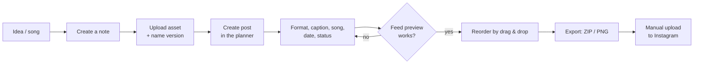
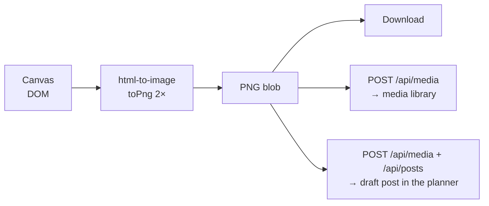
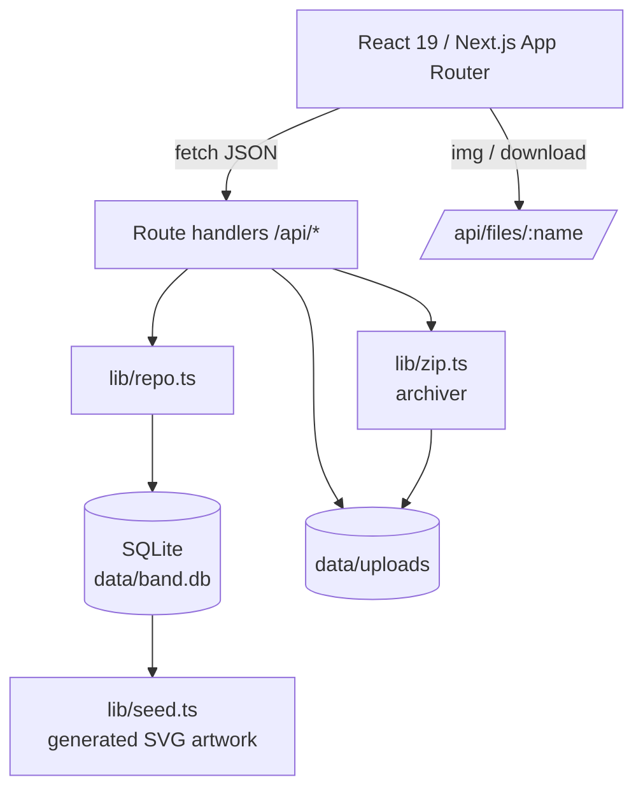

# DECHIRE · Band HQ – Concept & implementation plan

Goal: a **local backend with a UI** where a post-hardcore band plans its social media
presence – no agency tool, no cloud lock-in, no monthly subscription.

---

## 1. Starting point & requirements

From the brief:

1. **Instagram post planner** – create posts with image, caption and song, plan the feed and see a
   *professional preview* of how the profile will look; export for the real upload.
2. **Media library** – all media organised; when the logo is needed somewhere,
   grab the right **version** (transparent, white, sticker, square …) straight away.
3. **Notes** – another tool with *solid formatting options*.
4. Colour world: lots of black, accent **dark pastel lavender**, post-hardcore friendly, creative.

Quality goals derived from that:

| Goal | Implementation |
| --- | --- |
| “Actually feels like Instagram” | Real phone mockup with status bar, profile header, highlights, grid, post view, carousel, song ticker |
| Plan instead of administer | Drag & drop order, status (draft/scheduled/published), dates, countdown |
| Fast path to upload | Per-post ZIP with images in order + caption + guide, full plan as ZIP, PNG snapshot |
| Find assets again | Groups (assets) + versions, tags, search, usage counter |
| Frictionless writing | WYSIWYG with shortcuts, autosave, folders, tags, pinning |
| Local & robust | SQLite in-process, files on disk, no external services |

Non-goals (deliberate): automatic publishing via the Instagram API, multi-user accounts,
cloud hosting, analytics reporting. Those are sketched as roadmap.

---

## 2. User flow



---

## 3. Tool 1 – Instagram post planner

### 3.1 Data fields of a post

| Field | Purpose |
| --- | --- |
| `type` | Photo, carousel, reel, story – drives aspect ratio and badges |
| `status` | Draft, scheduled, published |
| `caption` | Max. 2,200 characters, the counter warns |
| `firstComment` | Hashtags/ticket link – kept separate, the way professionals do it |
| `media[]` | One asset or several in a defined order (carousel) |
| `songTitle` / `songArtist` | Instagram music tag, shown as a ticker in the mockup |
| `location` | Place in the post header |
| `altText` | Accessibility, ends up in the export |
| `scheduledAt` / `publishedAt` | Planning & history |
| `position` | Explicit feed order (drag & drop) |

### 3.2 Preview

- **Profile view**: avatar, posts, followers/following, bio, link, highlights, grid.
  Tiles show carousel/reel badges and a status label (draft/scheduled) – planner only, not in the export
  snapshot. Every tile is a button: clicking it opens that post in the single-post view.
- **Single-post view**: header with avatar + location, 4:5 (9:16 for stories), carousel navigation with dots,
  likes, caption with the real “more” fold, first comment, song ticker, location, timestamp. Prev/next arrows
  walk through the queue; a **1:1 toggle** shows the grid crop, so 4:5 artwork can be judged the way the
  profile will show it.
- Likes/comments are derived deterministically from the post ID – the preview feels alive without inventing
  real data.
- Scrolls like a real phone, but without the tab bar in the post view (closer to the original).

### 3.2a Writing captions without friction

- **Readiness row**: media, caption, hook, alt text, hashtags and date as chips above the editor tabs;
  clicking a chip jumps to its block, “Ready to schedule” appears when the required ones are green.
- **Caption meter**: character count, a marker at 125 characters where Instagram folds the text, and a hint
  how much of the hook stays visible.
- **Unicode text styles** (`lib/textStyles.ts`): bold, italic, script, outline, mono, small caps, wide,
  circled, squared, spaced, upside down, strike, underline – applied to the selection or the whole caption,
  with undo and “back to plain text”. These are real Unicode characters, so Instagram, the ZIP export and
  print keep them; the tool warns that screen readers may stumble over them.
- **Structure helpers** (rules, dots, slashes, bullets, numbers) and saved **snippets** for hashtag sets,
  captions and hooks. Alt text can be taken over from the asset with one click.


### 3.3 Queue
- The list *is* the feed order (position 1 top left) — the number sits on the thumbnail, the row shows status, date
  and a hover-only grip/export so the list stays quiet.
- Dragging sets the position through the API, the preview updates optimistically right away. **The profile grid
  is a drop surface too**: dragging a tile onto another one is the most direct way to design a grid, and it calls
  the same endpoint. Clicking a tile opens that post in the single-post view *and* in the editor.
- Filter by status; “sort by date” orders chronologically.
- Each row has a direct ZIP download.

### 3.4 Export

Two levels: *per post* (what you actually upload to Instagram) and *full* (backup/handover).

- Naming scheme `01-<title>-<version>.ext` so the carousel order is unambiguous on upload.
- `caption.txt` with a clear “first comment” separator.
- `post.json` machine-readable (song, alt text, media dimensions).
- `README.txt` with a six-step guide including the song search.
- PNG snapshot of the preview for band decisions – rendered client-side with `html-to-image`.

---

## 4. Tool 2 – Media library

### 4.1 Model: asset vs. file

The problem in the brief – “when I use my logo somewhere, I want the version I need” –
is solved by a two-level model:

```
Asset group "DECHIRE Wordmark"
├── Version "White / transparent"      1080×1080, SVG
├── Version "Lavender / transparent"   1080×1080, SVG
├── Version "Sticker 1080×1080"        1080×1080, SVG
└── Version "Social avatar"            1080×1080, SVG
```

- A group has a name + kind (logo/artwork/photo/merch/other).
- A file has a label, tags, alt text, dimensions, size, MIME and optionally a group.
- The group view shows stacked previews and the number of versions; a click opens the version list
  with “download version” and “details”.
- Usage counter: how many posts the file appears in (join over `post_media`).

### 4.2 Upload & organisation

- Multi-upload, drag & drop across the whole page, 80 MB limit per file.
- Dimensions are read server-side with `image-size` (including SVG, PNG, JPEG, WebP, AVIF).
- Editing happens in the detail dialog; deleting removes the DB row **and** the file.
- Logos are shown with `object-fit: contain` in previews, photos with `cover` – nothing gets cropped by accident.

---

## 5. Tool 3 – Notes

- TipTap 2 with StarterKit plus Underline, Link, Highlight, TaskList/TaskItem, TextAlign, Placeholder.
- Toolbar grouped (history · headings · characters · lists · blocks · alignment).
- Order: folders (free input with suggestions), tags, pinning, full-text search across title/body/tags.
- **Autosave**: every change (text *or* metadata) restarts an 800 ms timer;
  after saving it checks whether typing continued during the request – if so, it saves again.
  Status: *Unsaved / Saving … / Saved*. `⌘S` forces a save.
- Exported as a standalone, styled HTML file in the full ZIP.

---

## 6. Tool 4 – Design studio (post builder)

Goal: “as simple as Canva” – a blank sheet, a handful of tools, done is the Instagram image.
No account, no cloud, with immediate export into our own pipeline.

### 6.1 Why DOM instead of `<canvas>`

The canvas is **not** a `<canvas>` element but a DOM tree of absolutely positioned,
transformed nodes:

| Benefit | Why it matters |
| --- | --- |
| Text stays text | Inline editing with `contentEditable`, real web fonts, kerning by the browser |
| CSS effects for free | Gradients, `mix-blend-mode`, filters (grayscale, contrast), clip paths for stars/bursts |
| Scaling without re-implementation | The whole surface shrinks via `transform: scale(zoom)` – the layout stays identical |
| Export | `html-to-image` serialises the DOM node into an SVG and rasterises it – same look as the editor |

Limits (deliberate): no cut-outs/masks, no path editing tools, no layer groups.
That is roadmap, not v1.

### 6.2 Element model

Every element has a shared core and type-specific fields:

```
Base      { id, type, name, x, y, w, h, rotation, opacity, blendMode, locked, hidden }
Text      { text, fontFamily, fontSize, fontWeight, italic, uppercase, color, align,
            lineHeight, letterSpacing, outlineWidth, outlineColor, shadow,
            bgColor, bgPadding, bgRadius }
Shape     { shape, fillType, fill, gradientFrom, gradientTo, gradientAngle,
            strokeColor, strokeWidth, radius }
Image     { url, mediaId, fit, radius, grayscale, contrast, brightness,
            saturation, tintColor, tintOpacity }
Sticker   { glyph, color }
Texture   { texture, color, scale }
```

The order in the `elements` array **is** the layer order (back → front).
Everything is stored as JSON in the `designs` table – a design is therefore a
portable document, not a pile of pixels.

### 6.3 Tools

- **Text**: 6 presets, 9 fonts (Anton, Bebas Neue, Archivo Black, Oswald, Inter, Playfair Display,
  Space Mono + two system stacks), size, weight, tracking, line height, alignment,
  uppercase, italic, outline, five shadow modes, text background as a “pill”.
- **Shapes**: rectangle, circle, triangle, diamond, star, burst, cross, slash, line, frame, tape.
  Solid or gradient with an angle, stroke, corner radius. Stars/bursts/cross/slash via `clip-path`
  (procedurally computed polygons), strokes as inset shadows – so they clip exactly at the edge.
- **Media**: library + upload directly in the panel; image filters and tint as a colour overlay with `mix-blend-mode: color`.
- **Extras**: 10 stickers as inline SVG (scale losslessly, `currentColor`) and 6 textures
  (grain via SVG turbulence, halftone, scanlines, stripes, grid, vignette) with blend modes.
- **Layers**: visibility, lock, move up/down, delete, selection – and in the inspector
  “bring to front/send to back”. Locked elements are not grabbable but still selectable.

### 6.4 Interaction

- **Move**: pointer-down on an element, the delta is divided by the zoom.
- **Resize**: 8 handles. The delta is rotated into local space with the element rotation,
  the size is changed there and the centre is shifted by half the size change (also rotated) –
  so the opposite edge stays put, even on rotated elements. `Shift` keeps the aspect ratio.
- **Rotate**: handle above the box, angle from `atan2` around the element centre, `Shift` snaps to 15° steps.
- **Snapping**: edges and centres of the canvas and all other elements, threshold 8 screen pixels
  (divided by zoom), hits are shown as a red guide line.
- **Keyboard**: `⌘Z` / `⇧⌘Z`, `⌘D` duplicate, `⌘S` save, `Del`, arrow keys (with `Shift` = 10 px),
  `Esc` to deselect. History is a snapshot stack (max. 100 steps), drags push exactly one entry.
- **Autosave**: 900 ms debounce on `/api/designs/:id`, status indicator *Unsaved → Saving → Saved*.

### 6.5 Templates & formats

- Formats: feed 1:1 (1080×1080), feed 4:5 (1080×1350), story 9:16 (1080×1920).
- 7 templates, each with its own target format: release, show poster, lyrics, merch drop,
  story announcement, statement, band photo (automatically uses the newest photo from the library).
- “Fit elements to format” scales positions, sizes, font sizes and strokes proportionally.

### 6.6 Export pipeline



Important: rendering captures a **separate, invisible 1:1 copy** of the canvas
(`position: fixed; left: -20000px` on the wrapper, the captured element itself without positioning) –
capturing the shifted element directly would put the content outside the image.
Web fonts are embedded from the stylesheets by `html-to-image`; that is why only the
**latin subsets** of the Fontsource packages are loaded.

### 6.7 Google Fonts (search, but self-hosted)

- The catalogue comes from Google's public metadata list (`fonts.google.com/metadata/fonts`, ~1,900 families),
  fetched by our own server, trimmed to what matters and cached in `data/fonts/metadata.json` for a week.
- Picking a family downloads it **once**: `css2?family=…` with a browser UA, keep `latin` + `latin-ext`, up to
  three weights (400/700 plus one light or black), store the `woff2` files next to the catalogue and keep the
  `unicode-range` from the original rules.
- Serving, not linking: `lib/fonts.ts` generates the `@font-face` rules with **our own** URLs
  (`/api/fonts/file/…`), the client injects them as a `<style>` tag. That keeps DSGVO out of the equation, works
  offline afterwards and — the reason for the whole detour — lets `html-to-image` embed the type on export.
- The registered families are merged into the studio's font registry (`registerFonts` in `lib/design.ts`), so
  the canvas resolves them by id exactly like the built-in nine. The list is a `useSyncExternalStore` snapshot,
  which is what makes canvases and previews re-render when a font arrives.
- Removing a font deletes the row and its files; “Reset” clears the table too but keeps the catalogue cache.

## 7. Tools 5–8 – calendar, documents, brand sheet & workflow

The first four tools cover the feed. These cover the rest of band life: dates, paperwork, CI and the
small things that otherwise get lost.

### 7.0 Calendar (`/calendar`)

- **One timeline for posts *and* milestones** – the planner queue answers “in which order”, the calendar
  answers “when”. Toggling posts/milestones keeps the grid readable; a counter shows how many days of the
  month actually carry a post (cadence, not just content).
- Milestones: title, date, type (`release`, `show`, `deadline`, `meeting`, `content`, `other`), note, done flag
  and a **checklist** – the release template fills in cover formats, teaser, story, poster, merch, press text.
- `.ics` export (`/api/export/calendar`) for phones and shared calendars; an opt-in browser reminder fires
  30 minutes before a scheduled post and on the day of a milestone.

### 7.1 Milestone calendar (`/calendar`)

- Month grid, Monday first, 42 cells (previous/next month dimmed, today highlighted).
- A milestone is deliberately small: title, date, type, note, done flag. Types are `release`, `show`,
  `deadline`, `meeting`, `content`, `other` – the type drives the chip colour.
- Interaction: click selects a day, double-click or “Add milestone” creates, clicking a chip edits it.
  The side column shows the selected day plus the next six upcoming entries.
- Why not a full calendar with posts? Posts already live in the planner queue with their own dates;
  the calendar answers “what has a date but no feed post” – print deadlines, calls, shoots.

### 7.2 Documents (`/docs`)

- TipTap again, but with the **table extension**: a technical rider without a channel list is useless.
- Templates in `lib/docTemplates.ts`: technical rider (line-up, contacts, channel list, monitoring,
  lighting, power, hospitality), booking confirmation, itinerary, press text, stage plot, blank.
- Same autosave pattern as notes (900 ms debounce, version counter, `⌘S`, dirty/saving/saved state).
- Two exports, both without a server round-trip: **print → PDF** via a print stylesheet that hides
  navigation and renders the sheet black on white, and a **standalone HTML file** with inline styles
  for promoters who do not want a PDF. Images (logo, sheet image) are inlined as data URLs so the
  file is self-contained.
- **Sheet design, second pass** (`styles/docs.css`): the first version read like a business letter, so the
  sheet is now built like a flyer-with-paperwork instead of a letterhead. A **dark masthead** (`#0b0a10`)
  carries logo, the band name in the display face, the tagline in the accent colour, a rotated **stamp**
  (FINAL/DRAFT) and a mono meta row (`type · No. · date · handle`), closed by a two-tone accent hairline.
  Below it the body sits on bone paper with a grain dot pattern: `///` kicker, uppercase display title,
  a two-tone accent rule, **uppercase section headings** with a thin accent tick and a fading hairline,
  tables with night-coloured header cells (the rider look), italic accent-2 blockquotes and a closing
  footer line. Everything colour-related is `--accent` / `--accent-2` (including `--accent-rgb` for the
  translucent tints), so changing the accent in Settings changes the document too – no hardcoded lavender.
- **Emoji picker** (`components/EmojiPicker.tsx`) in the toolbar: five hand-picked groups (band, mood,
  orga, road, faces) plus the last ten picks from `localStorage`, inserted at the cursor via
  `editor.chain().focus().insertContent(emoji)`.
- **Sheet image** (maintainable, not a fixture): `profile.doc_media_id` + `profile.doc_mark_strength`
  (0–60 %, default 30 %). Settings → *Document sheet* picks any asset from the media library, sets the
  strength with a slider and shows a mini preview of the masthead. On the sheet the photo sits **behind the
  masthead** as a grayscale layer with a gradient veil, so it reads as a printed flyer background and never
  fights the text. Because it is a profile value, screen, print and HTML export render the same image at the
  same strength.
### 7.3 Brand sheet (`/brand`)

- A single page that answers “how do we look?” for printers, promoters, merch and support slots:
  logo on night and on bone, all CI colours with hex and role, four type specimens, do/don’t rules.
- Generated from live data (profile + palette), so there is no second design file to maintain.
- Export via `html-to-image`: PNG at 2× for chat and print shops, **SVG** (fonts and images embedded)
  for designers, plus the same print stylesheet for PDF.
- Deliberate limit: the sheet describes the system, it does not police it (a CI linter in the studio
  is on the roadmap).

### 7.4 Workflow: snippets, bin, search, backup

- **Snippets** (`snippets` table): hashtag sets, captions and hooks, inserted with one click into caption or
  first comment. The same text is never typed twice.
- **Bin** (`trash` table): deleting a post, document, milestone or note stores its payload first; restoring
  re-creates it as a new record. 60 entries max, so the bin cannot grow forever.
- **⌘K search** (`/api/search`): one query over posts, assets, notes, documents, milestones, designs and
  snippets, plus quick actions. With eight tools, finding beats browsing.
- **Backup/restore** (`lib/backup.ts`): a ZIP with a consistent database copy (after `wal_checkpoint`), all
  uploads and a manifest. Restore imports the rows into the live database instead of swapping files – no
  restart, no half-written database, and the open SQLite handle stays valid.
- **Media**: “replace file” swaps the file behind an asset (posts keep their reference) and the detail dialog
  lists every post using it.

### 7.5 Instagram & performance

- Publishing and insights go through the Meta Graph API (`lib/instagram.ts`): media container →
  `media_publish`, carousel via child containers, insights per media, long-lived token exchange.
- Hard requirements: Instagram **business** account, Meta app + app review for `instagram_content_publish`
  and `instagram_manage_insights`, and **publicly reachable image URLs** – the API fetches the media itself,
  so a localhost URL cannot work. `publicBase` stores that public prefix (tunnel or domain).
- Without credentials the whole flow runs in **sandbox**: identical buttons, simulated ids and numbers,
  labelled everywhere. That keeps the UI testable without an account.
- Results are stored in `post_metrics` (source `manual` or `instagram`); the dashboard derives reach totals,
  average reach and the best weekday from real numbers only. Manual entry stays possible.
- Stories are not part of content publishing – they stay a ZIP export.

**Auto-publish scheduler** (`lib/scheduler.ts`)

- Every minute a heartbeat in the app (and an external `POST /api/scheduler` for cron users) checks for
  scheduled posts whose time has come and publishes them through the same Graph call as the manual button.
- Guards: only runs in live mode (a sandbox run has to be triggered manually so demo data stays demo data),
  a 20 second throttle, a per-process lock, and a 2 minute visibility check so background tabs do not spam.
- Failures are stored on the post (`ig_error`, `ig_last_attempt`) and shown in the planner queue and in the
  insights tab; the last 40 runs are kept in `scheduler_log` and listed in the settings.
- Stories are skipped with an explicit error pointing at the ZIP export — the API has no story publishing.

### 7.6 Public website (`/site`) and its configuration (`/website`)

- Goal: a band that releases but does not play shows needs exactly one page. **First attempt was too cold** —
  giant type, abstract statements, countdown, release block, a scrolling marquee. All of it removed.
- The second attempt starts from the people: **a letter in first person**, a signature, who plays what, and a
  small corner of real photos. That is the whole difference between a press kit and a page someone believes.
- **Blocks, each switchable in the backend**: hero · a note from us · media corner · feed · say hi · footer
  (plus film grain as a global on/off). A block without content renders nothing, so an empty database still
  produces a valid page.
- **No countdown, no release block, no marquee.** Releases are announced where people look anyway: the feed
  strip or the letter. A clock that counts seconds makes an empty page feel emptier.
- **Atmosphere stays, noise goes**: slow image drift (48 s), grain/scanline/vignette overlays, an outlined
  echo of the band name, letter-by-letter reveal, hairline scroll progress, soft fade-ins on scroll. All of it
  is disabled under `prefers-reduced-motion`.
- **Media corner** instead of a release showcase: up to a handful of photos/clips from the library in a small
  mosaic (first item double size), optional teaser embed above, one italic caption below. Photos of people
  beat artwork every time.
- **Pre-launch**: `site.published = 0` renders only the gate (name, tagline, crew, Instagram) and sets
  `robots: noindex` — the page can be built in the open before the announcement.
- The configuration module mirrors the page one-to-one, so nothing exists on the site that cannot be edited:
  hero media/loop/veil, letter + signature + crew (`name — role` per line), media corner picker, teaser,
  labels, links, footer, meta description and an **own accent colour** (default = the HQ accent).
- **Reuse instead of duplication**: all photos are media library assets, the feed strip is built from
  **published posts** and links to their Instagram permalink, and the accent runs through `accentTokens`.
- **Live preview** in the backend: the saved page in an iframe with a desktop/mobile toggle; save → the iframe
  key changes and reloads. It shows the saved state on purpose — nothing half-typed leaks into the preview.
- One-pager CSS lives in `styles/site.css` and is scoped under `.site`, so the workspace chrome never inherits
  the cinematic rules. The shell split runs through route groups: `app/layout.tsx` = document only,
  `app/(hq)/layout.tsx` = sidebar + palette + toasts + scheduler heartbeat, `app/site/` = public layout.

---

### 7.4 Dashboard (`/`) – the second pass

The first dashboard showed everything it could: four stat cards (posts, published, media, notes), a
performance strip, "next up", a 3×3 feed preview, recently added assets and a notes list. Half of it was
decoration – a media counter does not help before a release, and a feed preview already exists in the
planner where you can actually edit it.

The rebuilt dashboard answers three questions only:

- **Coming up** – one timeline made of scheduled posts *and* dated milestones, sorted chronologically with
  date block, thumbnail/type icon, status pill, weekday + time and open-checklist count. This is the only
  place where posts and dates live side by side.
- **Needs you** – derived, not entered: drafts without a visual or caption, posts that go live within three
  days without media, milestones with open tasks in the next 21 days. Each row is a link into the exact
  editor. Sorted by urgency (overdue first), capped at five so it stays a nudge, not a backlog.
- **Performance** – reach total, average reach, best weekday and the last published post. Hidden behind a
  hint when nothing is measured yet.

Plus a small shortcuts row (documents, studio, notes, website) and the band's base figures in the panel head.
No counters that just count, no previews that duplicate a tool.

## 8. Design system

### Colours

| Token | Value | Use |
| --- | --- | --- |
| `--ink` | `#06060a` | Background, near black |
| `--panel` | `#100e17` | Cards, panels |
| `--text` | `#efeaf7` | Body copy |
| `--muted` | `#9a91b2` | Secondary text |
| `--accent` | `#b9a5e8` | Pastel lavender, interaction, focus (profile accent) |
| `--accent-rgb` | `185 165 232` | Same colour as `r g b` – every translucent tint uses `rgb(var(--accent-rgb) / x)`, so a new accent reaches every surface |
| `--accent-2` | derived | Second CI colour (`profile.accent_2_hex`, *Auto* = darker shade of the accent) – gradients, stamps, two-tone rules |
| `--accent-2-deep` / `--accent-2-soft` | derived | Depth + tint of the second colour |
| `--accent-deep` | `#6b54a6` | Gradients, depth |
| `--ok / --warn / --danger` | `#7fd3b0 / #e8c07d / #e4778b` | Status |

### CI palette “Bruised Bloom”

Emotional post-hardcore means, for us: **no cold agency CI**. The palette tells a
story – black stage, lavender haze, warm bone paper from copied flyers,
rust on the amp, a wound that never quite closes, and cold moss/fog grey in between
as a calm counterweight. Lavender stays the core (as originally requested) but gains
warmth and friction through rust and wound.

| Name | Hex | Role | Emotion / use |
| --- | --- | --- | --- |
| Night | `#08070b` | Base | Stage, ground, “everything off” |
| Ash | `#16121e` | Base | Panels, shadows with warmth |
| Dusk | `#2b2238` | Deep | Gradients, depth layering |
| Lavender | `#b9a5e8` | Primary | Core accent, light in the haze |
| Violet | `#6b54a6` | Accent | Gradient partner, depth in the accent |
| Bone | `#efe7da` | Paper | Warm white for type on dark |
| Rust | `#c86a4a` | Warm | Energy, amps, dust |
| Wound | `#c0455a` | Signal | Emotion, highlights, errors |
| Moss | `#7e9c94` | Calm | Cold counterweight, melancholy |
| Fog | `#8792a6` | Neutral | Secondary text, distance |

**Technically** the palette lives in the `palette` table (name, hex, role, position).
`PaletteProvider` loads it client-side and distributes it via context to every `ColorField` picker;
after saving in settings a `palette:updated` event fires so open editors immediately show
the new swatches. `PUT /api/palette` validates hex values and replaces the list atomically.
The demo reset restores the recommendation.

### Accent propagation

The accent is a single value (`profile.accent_hex`) that fans out into tokens in `lib/palette.ts`
(`accentTokens(hex, hex2)` → `--accent`, `--accent-rgb`, `--accent-2`, `--accent-2-rgb`,
`--accent-deep`, `--accent-2-deep`, soft/glow/line variants). `app/layout.tsx` renders it server-side,
`PaletteProvider` re-applies it in the browser, and the settings page dispatches `accent:updated`
with both colours for an instant switch.

Rule for new CSS: never hardcode a colour value of the accent – use `var(--accent)`,
`var(--accent-2)` or `rgb(var(--accent-rgb) / 0.12)`. The 93 old `rgba(185, 165, 232, …)` literals in
`styles/*.css` were replaced by exactly that, which is why notes, studio, planner, media, documents and
the dashboard all change with one colour now.

### Typography & texture

- Grotesk stack (Inter/SF/Helvetica), headlines 800–900 with negative tracking,
  mono labels in uppercase with wide letter-spacing – zine/poster feel without kitsch.
- Background: two lavender glows + fine SVG noise overlay (fixed, pointer-events: none).
- Cards with 1 px lines in lavender alpha, hover lift, soft drop shadows.
- Consistent “///” separators, status pills, locked lowercase for meta information.

### Interaction

- Sticky columns in the planner (editor left, preview centre, queue right), wrapping below 1,330 px,
  single column with the preview on top below 880 px.
- Modals via React portal into `body` – prevents sticky columns from covering dialogs.
- Toasts through a tiny event-bus module (`lib/toast.ts`), no context overhead.

---

## 9. Technical architecture



### Database (SQLite, `node:sqlite`)

```
media_groups (id, name, kind, description, created_at)
media        (id, group_id, variant_label, title, filename, original_name, mime,
              size, width, height, alt, tags, created_at)
posts        (id, type, status, caption, first_comment, alt_text, location,
              song_title, song_artist, scheduled_at, published_at, position, ...)
post_media   (id, post_id, media_id, position)          ← carousel order
notes        (id, title, content, plain_text, folder, tags, pinned, ...)
designs      (id, title, width, height, background JSON, elements JSON, ...)
milestones   (id, title, date, kind, note, done, ...)
documents    (id, title, kind, status, content, plain_text, tags, ...)
palette      (id, name, hex, role, position)
profile      (id=1, band_name, handle, bio, website, followers, following,
              avatar_media_id, highlight_names, accent_hex,
              doc_media_id, doc_mark_strength, ...)
site         (id=1, published, band_name, tagline, manifesto JSON (the letter),
              intro_title, intro_signature, crew JSON, hero_media_id, hero_video,
              hero_overlay, grain, media_title, media_note, media_ids JSON,
              show_hero/show_intro/show_media/show_feed/show_connect/show_footer,
              feed_title, teaser_url, show_teaser, links JSON, press_quote,
              press_source, footer_note, seo_description, accent_hex, updated_at)
```

- `node:sqlite` = **zero** native dependencies (no `better-sqlite3` build, no Prisma generator).
- Connection as a singleton on `globalThis` so hot reload does not open new handles.
- Connecting never writes to the file: `journal_mode` is only set when it is not `wal` yet and the
  seed transaction only runs when `profile` is empty. Otherwise Turbopack would rebuild on every
  request and reload the page in a loop.
- Schema changes for existing databases run through `ensureColumn()` (`PRAGMA table_info` + `ALTER TABLE`),
  so an old `band.db` keeps working after an update.
- The seed runs in a `BEGIN IMMEDIATE` transaction – safe with several workers.
- `PRAGMA foreign_keys = ON`; deleting a post clears `post_media` via CASCADE.

### Decisions & alternatives

| Decision | Why | Alternatives |
| --- | --- | --- |
| Next.js instead of Express + Vite | one process, one port, route handlers + React in one repo | Express + Vite (more boilerplate) |
| `node:sqlite` | no native builds, runnable immediately | better-sqlite3, Prisma, JSON store |
| Files on disk | real downloads, trivial ZIP export, backup = copy the folder | S3/blob (unnecessary locally) |
| TipTap | real ProseMirror model, clean HTML, extensible | contenteditable + execCommand (fragile) |
| Client rendering of the preview | instant feedback without a server round-trip | server snapshot via Playwright (heavy) |
| Generated SVG demo artwork | immediate impression in the band look, no licensing issues | stock photos (licences, size) |

---

## 10. Roadmap (after v1.0)

0. **Public website 2.0**: multiple pages (archive detail, imprint), an OG image generated from the cover,
   RSS/newsletter for releases, optional MP3 previews per release.
1. **Publishing**: Meta Graph API – publish scheduled posts automatically, incl. token management and error retries.
   (Done: scheduler, token refresh still button-less.)
2. **Thumbnails & image optimisation**: `sharp` pipeline (WebP thumbs, EXIF rotation, crop suggestions for 1:1 / 4:5 / 9:16).
3. **Planning beyond the edge**: mark “gaps” in the feed, link milestones to posts, recurring slots.
4. **Collaboration**: comments on posts, approval status (“reviewed by Jan”), activity log.
5. **Content library 2.0**: hashtag sets, caption templates, hook library, reuse in one click.
6. **More channels**: TikTok/YouTube Shorts formats (9:16), story export with safe zones.
7. **Backup/import**: JSON export of the whole database, import into a fresh install.
8. **Mobile PWA**: install on the phone, offline drafts in an IndexedDB cache.
9. **Design studio 2.0**: multi-select, groups, masks, path tools, a real brand kit
   (colours/fonts per band), derive templates from your own designs, crop directly on the canvas.

---

## 11. Acceptance criteria (met)

- [x] Post with image(s), caption, song, location, date, format and status can be created and edited.
- [x] Profile preview shows feed grid, profile header, highlights – updated live.
- [x] Post preview shows caption, song, likes, carousel.
- [x] Drag & drop order, “sort by date”, status filter.
- [x] Export per post (ZIP with images, caption, guide) and full (ZIP + CSV).
- [x] Feed snapshot as PNG.
- [x] Media upload, search, tags, groups with versions, download single versions, usage counter.
- [x] Notes with formatting, checklists, folders, tags, search, pinning, autosave.
- [x] Profile (handle, bio, followers, avatar, highlights) editable and visible in the preview.
- [x] Design studio: text, shapes, stickers, textures, media, layers, templates, 3 formats.
- [x] Move, resize, rotate, snapping, undo/redo, duplicate, lock, hide.
- [x] PNG export at 2× resolution, save to the library, straight to a draft post.
- [x] CI palette “Bruised Bloom” definable in one place, visible as its own row in every colour picker.
- [x] Interface accent colour changeable in the settings, applied instantly and persisted with the profile.
- [x] Calendar with milestones (type, note, done), month navigation, selected day and upcoming list.
- [x] Documents: technical rider and other templates, tables, autosave, draft/final, print-to-PDF and HTML export.
- [x] Brand sheet generated from profile + palette, exportable as PNG (2×), SVG and PDF.
- [x] Calendar shows scheduled/published posts and milestones together, with `.ics` export and reminders.
- [x] Milestone checklists incl. a release checklist template.
- [x] Documents render as a CI sheet (logo, header, accent rule, footer) in editor, print and HTML export.
- [x] Caption/hashtag/hook snippets insertable in the post editor.
- [x] Bin with restore for posts, documents, milestones and notes; ⌘K search across all content.
- [x] Backup and restore as a ZIP without restarting the server; media files can be replaced in place.
- [x] Instagram publishing + insights through the Graph API, with a clearly labelled sandbox mode.
- [x] Auto-publish scheduler for due posts, with run log, per-post errors and a manual “run now”.
- [x] Manual performance numbers and best-weekday insight from real data.
- [x] Public one-pager (`/site`) that reads like a letter: hero, letter + crew, media corner, feed strip, links,
      footer — every block switchable in `/website` with a live desktop/mobile preview, plus a pre-launch gate.
- [x] Black/lavender design, responsive down to mobile.
